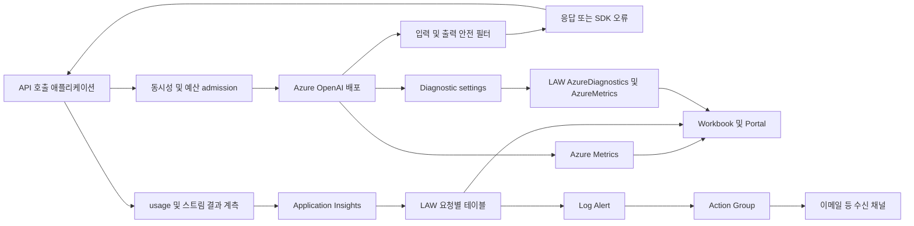
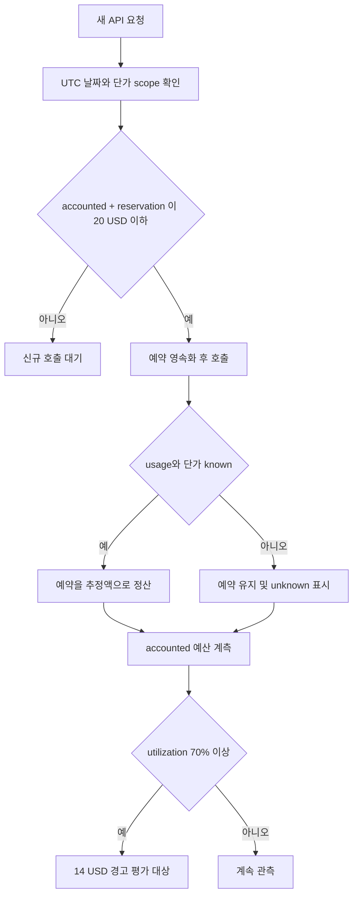
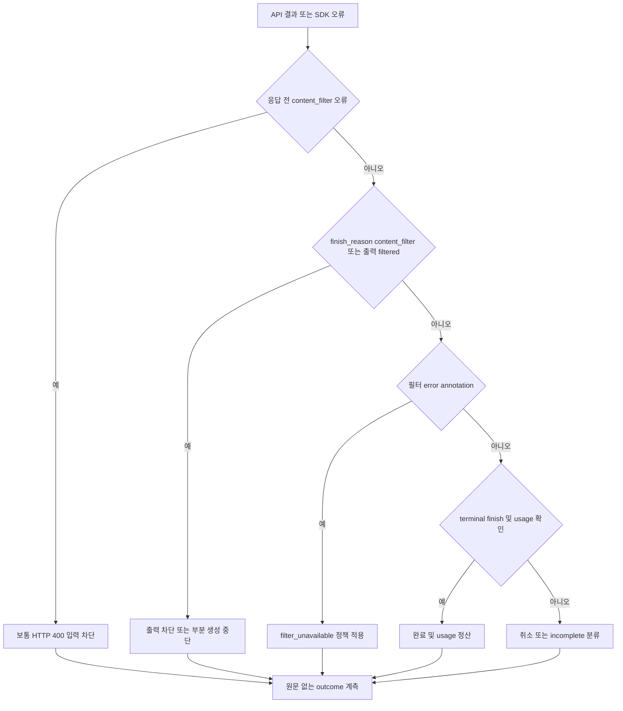

## 운영 범위와 읽는 순서

Azure OpenAI를 REST 또는 SDK로 직접 호출하는 애플리케이션을 대상으로 한다.
에이전트, 도구 호출 오케스트레이션, 에이전트 평가 기능은 범위에 포함하지 않는다.
먼저 요청 수, 429, 서버 오류, 스트리밍 지연을 확인하고, 토큰과 추정 비용,
입력 및 출력 필터 결과를 같은 배포와 시간 범위로 연결한다.

* Azure Metrics는 서비스가 수집한 요청, 토큰, 지연, 안전 지표를 확인하는 첫 화면이다.
* 호출부 계측은 클라이언트 체감 지연, 스트림 중단, 요청별 usage 및 필터 결과를 보완한다.
* Log Analytics Workspace(LAW)는 요청별 조사와 KQL 기반 경고에 사용한다.
* Cost Management는 청구 관점 대사에 사용한다. 초 단위 과금 차단기로 사용하지 않는다.

출처: [Azure OpenAI 모니터링](https://learn.microsoft.com/en-us/azure/foundry-classic/openai/how-to/monitor-openai),
[Cost Management 데이터 갱신과 지연](https://learn.microsoft.com/en-us/azure/cost-management-billing/costs/understand-cost-mgt-data#cost-and-usage-data-updates-and-retention).

> [!IMPORTANT]
> 아래 임계값은 운영 시작을 위한 예시다. Microsoft SLA, 서비스 보장값 또는
> production에서 검증한 SLO가 아니다. 데모의 실제 호출, synthetic fixture,
> 예산 admission control, Azure Alert 상태, 이메일 도착을 각각 구분한다.
> 2026-10-14의 저장된 증거는 당시의 스냅샷이지 현재 누적값이 아니다.

## 관측 구조와 데이터 흐름

### API와 관측 경로



읽기 흐름은 `호출 전 예산 예약 → API 호출 → 필터 및 스트림 결과 정규화 →
usage 기반 비용 추정 → 계측 export → LAW 조회 → 경고 평가 → 수신 확인`이다.
네이티브 Metrics와 호출부 계측은 서로 다른 관측 지점이다.
합산하여 요청 수를 두 배로 계산하지 않는다.

이 저장소는 `src/telemetry.ts`의 CLIENT span을 Application Insights로 export한다.
2026-10-14 read-only LAW 조회에서 현재 이벤트는 `AppDependencies`에 들어왔다.
기존 trace 방식의 `AppTraces`와 같은 테이블이라고 가정하면 안 된다.
현재 Properties 키는 `src/accounting.ts`의 `RequestEvent` 및 `toAttributes()`를 따른다.
별도의 `src/types.ts` 파일은 현재 없다.

출처: [Application Insights의 OpenTelemetry 수집](https://learn.microsoft.com/en-us/azure/azure-monitor/app/opentelemetry-overview),
[AppDependencies 스키마](https://learn.microsoft.com/en-us/azure/azure-monitor/reference/tables/appdependencies),
[AppTraces 스키마](https://learn.microsoft.com/en-us/azure/azure-monitor/reference/tables/apptraces).
저장소 근거: [계측](src/telemetry.ts), [이벤트 타입과 Properties 매핑](src/accounting.ts),
[운영 KQL](queries/live-operations.kql).

### 실제 결과와 미검증 범위

`artifacts\loadtest\continuous-verification.json`의 검증 시각은
`2026-10-14T11:37:48.128Z`(한국 시간 20:37:48)다.
worker `57fc8b39-51b7-4828-aa11-6d70b8e4d79e`를 기준으로 다음 결과를 저장했다.

| 구분                  | 당시 결과                          | 해석 및 경계                                                 |
|-----------------------|------------------------------------|--------------------------------------------------------------|
| 실제 API 요청 이벤트  | live 171건                         | 해당 검증 쿼리 범위의 수집 건수, 하루 전체 누적값 아님         |
| 실제 Azure 429        | 54건                               | live 요청 중 관측, fixture 429와 별도                         |
| synthetic 시나리오    | fixture 27건                       | 3개 모델 × 9개 결과 유형, 실제 안전 차단 증거 아님             |
| synthetic 안전 경고   | Guardrail Fired                    | fixture 기반 조건과 경고 평가 경로 확인                       |
| synthetic 429 경고    | throttle Fired                     | fixture 기반 경고, 실제 54건의 429 경고와 동일시하지 않음      |
| 실제 예산 계측        | 16개, 최대 utilization 0.018231455  | 약 1.823%, 70% 이상 샘플 0개                                  |
| 70% 예산 경고         | 해당 스냅샷에서 미발생              | $14 조건을 넘지 않았으므로 Fired를 검증했다고 주장하지 않음    |
| 실제 입력 안전 차단   | 관측되지 않음                      | harmless 호출이 성공한 결과, 필터 미작동 또는 우회 증거 아님   |
| Action Group readback | enabled, 이메일 수신자 1개          | 12:14:11Z 재확인, 주소 비공개, 실제 inbox 도착은 미검증        |
| 새 SWA 제어 화면      | 13:34~13:39Z 게시 및 정적 UI 로딩 확인 | 인증된 API 및 유료 cloud run 검증과 구분                       |

2026-10-14 최초 게시에서는 GitHub 인증과 익명 요청 401을 확인했다.
이후 고객 공유 요구에 따라
[게시된 정적 UI](https://white-stone-0001f860f.3.azurestaticapps.net)를
로그인 없는 공개 데모로 변경했다. 현재 익명 `/api/config`와 실행 시작은 HTTP 200이다.
모든 방문자가 일일 예산과 실행 상태를 공유하며 다른 방문자의 실행도 중지할 수 있다.

실행 시작 실패를 재현한 결과, Function의 경고 갱신 PUT이 HTTP 403이었다.
전용 경고 리소스의 Monitoring Contributor만으로는 연결된 LAW와 Action Group의
읽기 권한을 충족하지 못했다. 해당 LAW 범위의 Log Analytics Reader와
해당 Action Group 범위의 Reader를 추가하고 배포 스크립트에도 반영했다.
구독이나 리소스 그룹 전체 Contributor는 부여하지 않았다.
ARM 실패는 원문 응답 대신 상태와 제한된 오류 코드만 UI에 전달한다.
출처: [로그 경고 생성에 필요한 권한](https://learn.microsoft.com/en-us/azure/azure-monitor/alerts/alerts-create-log-alert-rule#prerequisites).

수정 후 API canary와 실제 브라우저 `실행 시작`으로 각각 3회를 호출했다.
각 실행에서 세 deployment가 1회씩 성공하여 총 6회 유료 호출과 usage를 확인했다.
첫 run은 `a215f13e-f99e-4690-aedc-6b45e43a67a3`,
브라우저 run은 `32870ed6-c444-415d-933d-30e220a081df`이며 모두 completed였다.
LAW `AppDependencies`에서도 각 run의 live 성공 3개를 확인했다.
브라우저 run의 합성 이벤트 27개는 live 3개와 분리되어 적재되었다.
이 결과는 실제 유해 입력 차단이나 이번 cloud canary의 실제 429 발생 증거가 아니다.

배포는 관리 그룹의 `MCAPSGovDeployPolicies`에 포함된
`StorageAccount_PublicNetwork_Modify` 및 `DisableLocalAuth` 정책을 존중했다.
Storage public network disabled 및 shared keys false를 유지하고,
Flex VNet과 Blob/Queue private endpoint 2개(Approved), private DNS를 구성했다.
정책 exemption 또는 완화로 우회하지 않았다.
Managed Identity의 Storage 역할 3개, OpenAI User 및
전용 경고 3개 범위의 Monitoring Contributor 권한을 확인했다.
공개 API의 예산 예약, 완료 조회와 새로고침 후 결과 복원으로
private Blob 실행 상태 저장 경로도 확인했다.

로컬 worker는 stopped이며 보수적 계상액은 $1.410790200000008이다.
수동 검증의 유한 cloud run만 실행했으며 무기한 자동 호출을 재개하지 않았다.
이번 브라우저 run 이후 Azure Alerts Management에서
`SYNTHETIC DEMO guardrail`은 14:58:51Z,
`SYNTHETIC DEMO throttle`은 14:59:12Z에 Fired로 확인했다.
이는 합성 이벤트의 경고 평가 증거이며 실제 모델 차단이나 429 증거가 아니다.
이메일 수신자는 Enabled이지만 수신함 접근 권한이 없어 실제 inbox 도착은 미검증이다.
현재 cloud canary는 과거 실제 429 54건 및 synthetic Fired 기록과 별개의 증거다.

근거: 2026-10-14 익명 API/브라우저 canary 응답과 LAW 조회.
출처: [Static Web Apps 인증과 권한](https://learn.microsoft.com/en-us/azure/static-web-apps/authentication-authorization),
[App Service 및 Functions 인증](https://learn.microsoft.com/en-us/azure/app-service/overview-authentication-authorization),
[Storage private endpoint](https://learn.microsoft.com/en-us/azure/storage/common/storage-private-endpoints).

이 검증 파일에는 실제 `latency-p95`, `throttle-rate`의 Fired 기록도 있다.
이는 위 synthetic 전용 경고와 별개의 운영 경고다.
이메일 수신자 설정, Azure의 테스트 알림 발송 응답, 실제 inbox 수신은 서로 다른 증거다.
`Fired`만으로 사용자가 메일을 읽었다고 판단하지 않는다.

출처: [경고 상태와 모니터 조건](https://learn.microsoft.com/en-us/azure/azure-monitor/alerts/alerts-overview),
[Action Group과 알림 테스트](https://learn.microsoft.com/en-us/azure/azure-monitor/alerts/action-groups).
저장소 근거: [지속 부하 검증 스냅샷](artifacts/loadtest/continuous-verification.json),
[시나리오 생성 및 경고 조건](src/demo-scenarios.ts),
[예산 경고 정의](artifacts/loadtest/alert-budget.json),
[이메일 테스트 응답](artifacts/email-test.json), [설정 리소스 참조](artifacts/settings.json).

### 부하 목표와 관측값

설정 모델은 `gpt-6-luna`, `gpt-5.6-luna`, `gpt-5.6-terra`다.
각 배포 SKU는 `GlobalStandard`이며 모델 버전은 각각
`2026-09-22`, `2026-07-09`, `2026-07-09`다.
모델명과 버전은 저장소 설정값이다. 모든 구독과 지역에서 가용하다는 의미는 아니다.

burst 설정은 **목표 30 RPS, 2초에 60회, 300초 간격**, 최대 동시성 64다.
일반 wave는 동시성 2, 완료 후 기본 대기 20초다.
API 처리 시간, 예산 예약의 디스크 기록, 인증, backoff 때문에 목표 스케줄과 실제 시작률은 다를 수 있다.
300초마다 정확히 실행되었다고 단정하지 않고 request-start 시각으로 검증한다.

`status.json`의 `2026-10-14T12:06:06.772Z` 스냅샷에서는 다음을 관측했다.

* 마지막 burst issued 60회, peak inflight 40, 최고 1초 bucket 시작 수 19회
* UTC 당일 journal 기준 attempts 756, successes 531, throttled 224
* known usage 531, unknown cost 225, 알려진 토큰 input 75,593 및 output 47,860
* 알려진 usage 기반 추정 비용 $0.2676256, 보수적 accounted $1.0319648
* `pendingReservations` 1, 예산 utilization 약 5.160%, 상태 `throttling_backoff`

이는 11:37 검증 스냅샷의 171건과 다른 집계다.
status의 당일 집계는 journal 전체를 읽으며, status의 worker ID가 모든 당일 이벤트의 worker를
필터링하는 것은 아니다. worker 실행 중 갱신되는 파일이므로 열어 보는 시점에는 값이 바뀔 수 있다.
TTFT p95 3,572ms는 TTFT가 있는 81개 관측치 기준이다.
duration p95 6,065ms는 다른 분모의 값이다. 작은 데모 표본을 모델 성능 벤치마크로 사용하지 않는다.

출처: [Azure OpenAI quota와 rate limit 계산](https://learn.microsoft.com/en-us/azure/foundry/openai/how-to/quota#understanding-rate-limits).
저장소 근거: [모델 설정](config/models.json), [부하 설정](config/load-test.json),
[갱신형 상태 파일](artifacts/loadtest/status.json), [worker 집계](src/load-worker.ts),
[부하 요약 수식](src/load-policy.ts).

## Azure 네이티브 Metrics 읽기

### 이름과 차원을 먼저 확인

Portal에서 Azure OpenAI 리소스의 **Monitoring → Metrics**를 연다.
namespace는 `Microsoft.CognitiveServices/accounts`다.
ARM metric definitions에 있는 REST 이름으로 필터와 경고를 연결하고,
표시 이름이 비슷하다는 이유만으로 다른 지표를 대체하지 않는다.
같은 리소스에 여러 API 계열 지표가 나타날 수 있다.

2026-10-14에 `artifacts\settings.json`의 `openAiResourceId`로
`az monitor metrics list-definitions`를 read-only 실행했다.
아래 Azure OpenAI 및 RAI 지표의 정의가 실제 리소스에서 확인되었다.
Metrics API에서 요청 수, 입력 및 출력 토큰, `AzureOpenAITimeToResponse`의
비영(non-zero) 표본도 확인했다. `RAIHarmfulRequests`는 조회 표본에서 0이었다.
정의 존재는 모든 배포에서 값이 발생했다는 증거가 아니며, 값 0과 데이터 없음도 다르다.

출처: [공식 모니터링 데이터와 metric 정의](https://learn.microsoft.com/en-us/azure/foundry/openai/monitor-openai-reference),
[ARM Metric Definitions API](https://learn.microsoft.com/en-us/rest/api/monitor/metric-definitions/list).
현장 근거: `artifacts\settings.json`에 기록된 리소스 범위의 ARM readback,
Metrics API의 `2026-10-14T12:11:00Z` 표본.

### 핵심 요청과 토큰 지표

| REST 이름                 | 의미 및 집계                                             | 운영 시 주의                                             |
|---------------------------|----------------------------------------------------------|----------------------------------------------------------|
| `AzureOpenAIRequests`      | API 요청 수, `Total`                                      | StatusCode, 배포, StreamType별로 분리                      |
| `ProcessedPromptTokens`   | 처리한 입력 prompt 토큰 수, `Total`                       | 요청 수가 아니라 토큰량, 캐시별 가격 산정은 별도           |
| `GeneratedTokens`         | 생성한 출력 completion 토큰 수, `Total`                  | max tokens 설정값이 아니라 실제 생성량                    |
| `TokenTransaction`        | 입력 + 출력 inference 토큰 수, `Total`                   | 앞의 두 토큰 지표와 다시 더하면 중복                       |
| `AzureOpenAIAvailabilityRate` | 서비스 가용성 비율, 기본 `Average`, Percent            | 애플리케이션 종단 가용성 및 자체 SLO와 동일하지 않음       |

`AzureOpenAIRequests`의 ARM 차원에는 `ModelDeploymentName`, `ModelName`,
`ModelVersion`, `StatusCode`, `StreamType`, `ApiName`, `OperationName`, `Region`,
`IsSpillover`, `ServiceTierRequest`, `ServiceTierResponse`가 있다.
토큰 지표 차원은 같지 않다. `ProcessedPromptTokens`, `GeneratedTokens`, `TokenTransaction`에는
`FeatureName`, `UsageChannel` 등도 있으며 요청 수 지표의 모든 차원을 그대로 사용할 수 없다.
429 비율은 같은 배포와 시간 창의 `429 요청 수 / 전체 API 요청 수`다.
StatusCode 차원의 실제 값부터 확인하고 splitting 또는 필터를 적용한다.

ARM에 `InputTokens`, `OutputTokens`, `TotalTokens`, `cacheReadInputTokens`,
`ephemeral5mInputTokens`, `ephemeral1hInputTokens` 등의 정의도 보였다.
특정 모델/API에 적용되는 범위와 emitted 값을 확인하기 전에는
기존 Azure OpenAI 토큰 지표와 합산하거나 캐시 청구 근거로 사용하지 않는다.

출처: [지원 Metrics, 차원, 단위와 집계](https://learn.microsoft.com/en-us/azure/foundry/openai/monitor-openai-reference#metrics),
[Cognitive Services 지표 목록](https://learn.microsoft.com/en-us/azure/azure-monitor/reference/supported-metrics/microsoft-cognitiveservices-accounts-metrics).

### 지연과 처리 속도 지표

| REST 이름                        | 서비스 측 의미                                                | 클라이언트 관측과의 차이                              |
|----------------------------------|---------------------------------------------------------------|------------------------------------------------------|
| `AzureOpenAITimeToResponse`        | API gateway에서 첫 응답이 보일 때까지, ms, 기본 `Average`       | 스트리밍 responsiveness, 클라이언트 네트워크 미포함   |
| `AzureOpenAINormalizedTTFTInMS`    | 토큰으로 정규화한 모델 측 first-byte 시간, ms                   | 화면의 첫 content token 시간 자체가 아님              |
| `AzureOpenAINormalizedTBTInMS`     | 스트리밍 모델 토큰 생성 간격 지표, ms                          | content chunk 사이 간격과 토큰 사이 간격은 다름       |
| `AzureOpenAITTLTInMS`             | 모델 측 마지막 byte까지 시간, ms                              | 클라이언트 전체 요청/stream duration과 구분           |
| `AzureOpenAITokenPerSecond`        | 모델 토큰 생성 처리 속도                                      | 전체 요청의 RPS와 다름                               |

`TimeToResponse`, `TimeToLastByte`, `NormalizedTimeToFirstToken` 같은 이름도
리소스에 함께 존재했다. 이 가이드는 Azure OpenAI 전용 이름을 기준으로 설명한다.
포털의 평균 지연을 요청별 p95로 읽지 않는다.
시간 bucket 평균들의 p95도 요청 전체의 p95가 아니다.

데모의 `aoai.ttft_ms`는 클라이언트 호출 시작부터 비어 있지 않은 첫 `delta.content`까지다.
첫 chunk가 role 또는 annotation만 포함하면 `aoai.first_chunk_ms`와 다르다.
`aoai.stream_duration_ms`는 전체 요청 시간이다.
`aoai.inter_chunk_mean_ms`는 content chunk 간격이며 native TBT와 직접 같지 않다.

출처: [네이티브 latency 정의와 클라이언트 측 한계](https://learn.microsoft.com/en-us/azure/foundry/openai/monitor-openai-reference#metrics),
[지연에 영향을 주는 입력 길이와 출력 토큰](https://learn.microsoft.com/en-us/azure/foundry/openai/how-to/latency).
저장소 근거: [스트림 측정 로직](src/streaming.ts), [스트리밍 운영 KQL](queries/streaming.kql).

### 안전 지표와 PTU 지표

| REST 이름                         | 의미                                                   | 집계 및 판단 주의                                        |
|-----------------------------------|--------------------------------------------------------|----------------------------------------------------------|
| `RAITotalRequests`                 | 안전 필터 관련 전체 요청 지표                          | `Total`, API 전체 분모와 동일하다고 가정하지 않음          |
| `RAIHarmfulRequests`               | 유해로 탐지한 호출, blocking과 annotate 모드 포함        | `TextType`, `Category`, `Severity`별 차원 확인             |
| `RAIRejectedRequests`              | 안전 필터가 거부한 호출                                 | `TextType`, `Category`로 입력 및 출력 경로 조사            |
| `RAISystemEvent`                   | safety 관련 시스템 이벤트                              | EventType 확인, 정의의 기본 집계 `Average` 확인            |
| `AzureOpenAIProvisionedManagedUtilizationV2` | Provisioned 배포 사용률, Percent              | 이 데모는 GlobalStandard이므로 PTU 포화 경고를 적용하지 않음 |

`RAIHarmfulRequests`는 탐지량이지 곧바로 차단량이 아니다.
한 요청이 여러 category 또는 입력/출력에 나타날 수 있으므로 차원별 합계를
고유 차단 요청 수나 분모 없이 차단율로 바꾸지 않는다.
정확한 애플리케이션 차단율은 요청별 최종 outcome으로 계산한다.
탐지량 0은 안전성이 인증되었다는 뜻이 아니다.

`BlockedCalls`는 정의에 나타났지만 공식 설명에 **Azure OpenAI에 사용하지 말라**고 명시되어 있다.
429에는 `AzureOpenAIRequests`의 StatusCode 또는 실제 요청 로그를 사용하고,
콘텐츠 거부에는 `RAIRejectedRequests` 및 API 필터 결과를 사용한다.
`ContentSafetyBlockedRequests` 같은 확인하지 않은 이름을 네이티브 지표로 제시하지 않는다.

출처: [RAI와 BlockedCalls의 공식 의미](https://learn.microsoft.com/en-us/azure/foundry/openai/monitor-openai-reference#metrics),
[Provisioned 처리량 운영](https://learn.microsoft.com/en-us/azure/foundry/openai/concepts/provisioned-throughput).

### Metrics와 LAW export의 차이

Metrics Explorer 및 Metrics API에서는 지원 차원으로 배포와 상태 코드를 나눌 수 있다.
Diagnostic settings의 Metrics export는 다차원 지표를 차원 전체 합계로 평탄화한다.
따라서 LAW의 `AzureMetrics`에서 `AllMetrics`를 받았다는 이유만으로
배포별 429, 모델 버전별 토큰 또는 차원별 원본을 복원할 수 없다.
공식 표의 `DS Export` 지원 여부와 설정의 enabled 여부도 각각 확인해야 한다.

권장 분리는 `네이티브 다차원 추세 → Metrics API/Explorer`,
`요청별 상세, p95, usage coverage → LAW 호출부 로그`다.
대시보드의 Metrics 패널과 LAW 패널은 같은 시간대를 사용하되 수집 지연, 필터,
관측 위치가 다르다는 설명을 붙인다.

출처: [Diagnostic settings의 다차원 Metrics 제한](https://learn.microsoft.com/en-us/azure/azure-monitor/essentials/diagnostic-settings#metrics-limitations),
[Azure OpenAI DS Export 지원 표](https://learn.microsoft.com/en-us/azure/foundry/openai/monitor-openai-reference#metrics).

## 경고를 만드는 기준

### 시작 임계값과 최소 표본

다음은 production 적용 전 조정할 **시작 예시**다.
모델, 배포, 지역, 스트리밍 여부, 입력 크기 및 출력 상한별로 기준선을 만든다.
백분율의 분모는 fixture를 제외한 같은 범위의 실제 요청이다.
최소 20건이라는 데모 기준은 통계적 충분성을 보장하지 않는다.
트래픽이 충분한 서비스에서는 p95에 100건 이상 등 더 큰 최소 표본을 검토한다.

| 관측 항목             | 경고 시작 예시                                     | 다음 행동                                                   |
|-----------------------|----------------------------------------------------|-------------------------------------------------------------|
| 5xx 및 네트워크 오류  | 15분, 배포별 요청 ≥20, 오류율 ≥5%                   | 429/400과 분리, retry 후 사용자 실패율도 별도 확인            |
| 429                   | 15분, 배포별 요청 ≥20, 429 비율 ≥5%                 | TPM/RPM, burst, 출력 상한, 동시성 및 quota 확인               |
| 클라이언트 TTFT       | 15분, 측정 ≥20, p95 >3초                           | prompt/cache/네트워크/동시성 확인, native 평균과 비교          |
| 전체 stream duration  | 성공 ≥20, 15분 p95 >5초                             | 요청 길이별 SLO, 출력 상한별로 나누어 오탐 줄임               |
| stream incomplete     | 15분 3건 이상                                      | 사용자 취소는 별도, timeout과 연결 종료 원인 조사             |
| filter unavailable    | 15분 1건 이상                                      | 필터 실패 처리 정책과 fail-open 위험 우선 검토                |
| 차단율 변화           | 15분 실제 요청 ≥100, 평소 대비 2배 및 5% 이상       | 정책 변경, 오탐 및 입력 구성 변화 조사, 차단 자체를 장애로 보지 않음 |
| 토큰 급증             | 배포별 5분 output >100,000 또는 평소 대비 2배       | 데모 수치, 출력 상한/호출 증폭/예산 확인                      |
| PTU 사용률            | PTU인 경우에만 5분 평균 >80%, >90% 지속 시 상향     | quota, 용량과 throughput 검사, GlobalStandard에는 적용 안 함 |
| 알려진 추정 지출      | 5분 합계가 서비스별 승인한 달러 한도 초과          | unknown 비용 비율 동시 표시, 청구 경고와 분리                 |
| 예산 admission        | UTC/day $20, accounted ≥$14에서 70% 경고           | $20 예약 한도에서 신규 호출 중지, Alert 평가를 기다리지 않음  |

지속성은 예를 들어 3회 평가 중 2회 초과 조건으로 시작하고,
on-call 대상은 심각도와 고객 영향에 맞춘다.
예산처럼 즉시 통제가 필요한 항목은 호출 전 admission control로 처리한다.
고객 입력 차단, 성능 저하, 서비스 장애를 하나의 ERROR 비율로 섞지 않는다.

출처: [Metric alert 구성과 차원](https://learn.microsoft.com/en-us/azure/azure-monitor/alerts/alerts-create-metric-alert-rule),
[Log search alert 구성](https://learn.microsoft.com/en-us/azure/azure-monitor/alerts/alerts-create-log-alert-rule),
[Azure OpenAI quota](https://learn.microsoft.com/en-us/azure/foundry/openai/how-to/quota).
저장소 근거: [7개 운영 Log Alert와 native 토큰 Alert](infra/resources.bicep),
[별도 70% 예산 및 synthetic 경고](src/demo-scenarios.ts).
표의 차단율/PTU 예시는 운영 제안이며 이 저장소에 모두 구현되어 있다는 뜻은 아니다.

### 저트래픽 및 수집 중단 감시

요청이 적으면 `Requests >=20` 조건 때문에 실제 장애도 비율 경고에 나타나지 않을 수 있다.
업무 시간대 heartbeat, 안전한 최소 synthetic 가용성 probe의 연속 실패,
마지막 live 이벤트 시각 및 ingestion 상태를 독립적으로 감시한다.
probe는 fixture와도 실제 사용자 호출과도 구분하여 태그를 남긴다.
이 저장소에서 별도 production probe가 구현되었다고 주장하지 않는다.

로그 없음은 `사용자 호출 없음`, `클라이언트 중단`, `export 실패`, `LAW 지연`,
`일일 수집 한도 도달`, `쿼리 필터 오류`를 각각 조사한다.
데모는 LAW retention 30일 및 daily quota 1GB를 설정한다.
로그 수집 한도는 모델 API 과금을 중지하는 기능이 아니다.

출처: [Application Insights 가용성 검사](https://learn.microsoft.com/en-us/azure/azure-monitor/app/availability),
[LAW daily cap 동작](https://learn.microsoft.com/en-us/azure/azure-monitor/logs/daily-cap).
저장소 근거: [ingestion health KQL](queries/ingestion-health.kql), [LAW 설정](infra/resources.bicep).

## 실시간 토큰 및 추정 비용

### 스트리밍 중 무엇을 알 수 있는가

stream 요청에 `stream_options: { include_usage: true }`를 사용하면
마지막 추가 chunk의 usage에 요청 전체 토큰이 포함된다.
중간 chunk의 usage는 null일 수 있고, 마지막 usage chunk의 choices는 빈 배열이다.
완료 전에 끊기면 최종 usage를 받지 못할 수 있다.
chunk 수, 문자열 길이 또는 화면에 보인 단어 수를 청구 토큰으로 취급하지 않는다.

출처: [공식 API의 stream_options 및 include_usage](https://learn.microsoft.com/en-us/azure/ai-foundry/openai/reference-preview-latest#components).
저장소 근거: [실제 호출 옵션](src/load-api.ts), [빈 choices 및 usage 처리](src/streaming.ts).
데모 API 버전은 `2024-10-21`이며 고객 API/SDK 버전의 지원 여부는 별도 확인한다.

화면에는 다음 세 값을 나누어 표시한다.

* 진행 중 예약량: 호출 전 입력 및 출력 상한을 사용한 보수적 예산 값
* 완료 후 usage: API가 반환한 input/output/cached token, known 여부 포함
* 수집 후 추세: LAW 및 Metrics에서 지연을 포함해 집계한 결과

데모 exporter의 기본 batch 대기는 1초이고 wave 이후 flush도 수행하지만,
LAW 수집 및 대시보드 갱신까지 1초라고 보장하지 않는다.
사용자에게 필요한 빠른 진행 상태는 로컬 ledger 또는 앱 상태에서 제공하고
Azure Monitor는 독립적인 수집 결과로 대사한다.

출처: [Azure Monitor 로그 수집 지연](https://learn.microsoft.com/en-us/azure/azure-monitor/logs/data-ingestion-time).
저장소 근거: [batch 및 flush](src/telemetry.ts), [journal과 상태 갱신](src/load-worker.ts).

### 비용 수식과 단가의 유효 범위

입력 토큰 P에 cached input C가 이미 포함된 경우, 요청별 추정은 다음과 같다.

```text
estimated USD =
  ((P - C) × input price + C × cached-input price + O × output price) / 1,000,000

P: 실제 prompt_tokens
C: 실제 prompt_tokens_details.cached_tokens
O: 실제 completion_tokens
```

usage가 없으면 비용은 `null`/unknown이다.
조회 시 합계가 0이라고 해도 unknown 요청의 실제 비용이 0이라는 뜻은 아니다.
데모는 cached details가 없을 때 C=0으로 계산할 수 있지만,
`aoai.cache_details_known=false`로 근거 부족을 표시한다.
그 값은 캐시 사용이 없었다는 측정 증거가 아니다.
별도의 cache-write token이 있거나 price scope를 벗어나면 지원하지 않는 비용으로 처리한다.
reasoning token은 completion 세부 구성에 포함될 수 있으므로 output에 중복 가산하지 않는다.

출처: [API usage 및 token details](https://learn.microsoft.com/en-us/azure/ai-foundry/openai/reference-preview-latest#components),
[Azure OpenAI 가격 구분](https://azure.microsoft.com/en-us/pricing/details/azure-openai/).
저장소 근거: [usage와 비용 수식, scope 검증](src/accounting.ts),
[단가 매핑 KQL](queries/cost-rate-mapping.kql).

아래는 **저장소에 구성된 계산 예시**다.
이 가이드 작성에서 세 모델의 현재 시장 단가를 독립적으로 다시 검증한 것은 아니다.
`model-prices.json`에는 `status=verified`와 과거 검증 시각이 있지만,
그 metadata와 지금의 시장 가격 확인은 구분한다.
USD per 1M tokens, East US 2, GlobalStandard, short context,
prompt 4,096 token 이하라는 구성 범위를 함께 적용한다.

| 구성 모델       | Input | Cached input | Output | Cache write metadata |
|-----------------|-------|--------------|--------|----------------------|
| gpt-6-luna      | $0.10 | $0.01        | $0.50  | $0.125               |
| gpt-5.6-luna    | $0.20 | $0.02        | $1.20  | $0.25                |
| gpt-5.6-terra   | $2.00 | $0.20        | $12.00 | $2.50                |

구성 유효기간은 `2026-10-14 <= UTC 날짜 < 2026-11-14`다.
`effectiveTo`는 끝 날짜를 포함하지 않는다.
cache-write 단가는 metadata에 있지만 현재 driver는 별도 cache-write 과금을 구현하지 않는다.
가격 만료, 모델 버전/SKU 불일치 및 다른 context 범위를 무시하고 계산하지 않는다.
예를 들어 gpt-5.6-terra의 P=1,000, C=200, O=100이면 위 예시 단가의 추정은
$0.00284다. 계약 가격, 할인, 세금 및 Azure 청구 금액과 같다는 의미는 아니다.

출처: [공식 가격 확인 지점](https://azure.microsoft.com/en-us/pricing/details/azure-openai/),
[Azure Retail Prices API](https://learn.microsoft.com/en-us/rest/api/cost-management/retail-prices/azure-retail-prices).
저장소 근거: [모델별 구성 단가](config/model-prices.json),
[기존 가격 확인 evidence](config/azure-price-evidence.json),
[독립적인 illustrative 수식 예제](config/prices.json).

### $20 예산과 실제 청구의 분리

worker는 **UTC 하루 $20**을 모델 호출 admission 한도로 사용한다.
호출 전에 reservation을 영속화하고,
완료 후 알려진 추정액으로 정산한다.
usage 또는 가격을 알 수 없으면 예약액을 보수적으로 유지한다.
미완료 pending reservation도 별도 표시한다.
`accountedUsd`는 안전한 호출 승인 판단을 위한 값이지 invoice 금액이 아니다.
모든 과금 경로에 대한 절대 상한을 보장하지 않으며 다른 앱의 호출은 통제하지 않는다.



읽기 흐름은 `현재 budget 확인 → 최대 예상액 예약 → 호출 →
known 정산/unknown 예약 유지 → $14 경고 → $20에서 신규 승인 중지`다.
경고 이메일이 오기 전에도 admission control은 동작해야 한다.
UTC 자정은 한국 시간 오전 9시이며 한국 달력 날짜와 일일 집계가 다를 수 있다.

출처: [예산 경고의 평가 주기](https://learn.microsoft.com/en-us/azure/cost-management-billing/costs/manage-automation#automate-alerts-and-actions-with-budgets).
저장소 근거: [reservation 및 budgetAllows](src/load-policy.ts),
[UTC 예산 영속화와 정산](src/load-worker.ts), [70% 경고 조건](src/demo-scenarios.ts).

Cost Management의 데이터는 EA/MCA에서 통상 8~24시간, pay-as-you-go에서는
최대 72시간 지연될 수 있다. 예산 비용 평가는 하루 한 번이므로
요청별 급증에는 앱 ledger와 제어가 필요하다.
매일 ledger를 청구 데이터와 대사하고, streaming interruption 및 unknown 비용을 조사한다.
Static Web Apps Standard, Functions, Storage, private endpoints, DNS,
LAW 수집, Application Insights 및 Managed Grafana 등 호스팅/관측 비용은
모델 토큰 예산과 별도 관리한다.
자동 청구 대사 커넥터가 이 저장소에 구현되었다고 주장하지 않는다.

출처: [Cost Management 갱신 지연](https://learn.microsoft.com/en-us/azure/cost-management-billing/costs/understand-cost-mgt-data#cost-and-usage-data-updates-and-retention),
[Azure Monitor 비용](https://learn.microsoft.com/en-us/azure/azure-monitor/fundamentals/cost-usage).

## 기본 guardrail과 필터 설정

### 입력 및 출력 정책을 배포에 연결

기본 안전 필터는 hate, sexual, violence, self-harm 범주와
safe/low/medium/high 심각도를 사용한다.
입력과 출력 각각 threshold를 선택한다.
Medium을 선택하면 해당 범주의 medium 및 high를 차단하는 정책이 된다.
탐지 annotation과 실제 blocking은 서로 다른 결과다.

데모 Bicep는 `demo-medium` 정책을 만들어 4개 범주의 Prompt 및 Completion을
`enabled=true`, `blocking=true`, `severityThreshold=Medium`으로 설정하고
각 deployment의 `raiPolicyName`에 연결한다.
이는 소스 구성 증거다. production에서는 배포별 실제 정책 readback을 추가 확인한다.

1. Foundry의 content filters 화면에서 입력 및 출력 정책을 각각 확인한다.
2. 업무 정책에 맞는 threshold를 선택하고 변경 이력과 승인자를 남긴다.
3. 모델 deployment에 해당 정책을 연결한다. 정책 생성만으로 적용되었다고 판단하지 않는다.
4. harmless 호출로 정상 usage와 annotation을 확인한다.
5. 차단 UI와 오류 처리 경로는 별도 fixture로 검증한다.
6. 실제 안전성 평가는 승인된 절차와 데이터셋으로 수행하고 fixture 결과와 구분한다.

출처: [Content filter 설정과 배포 적용](https://learn.microsoft.com/en-us/azure/ai-foundry/openai/how-to/content-filters),
[필터 범주와 심각도](https://learn.microsoft.com/en-us/azure/ai-foundry/openai/concepts/content-filter).
저장소 근거: [demo-medium 정책과 배포 연결](infra/resources.bicep).

### 기본 guardrail은 계층별로 적용

콘텐츠 필터만으로 모든 요구를 충족하지 않는다.
인증과 배포 범위 권한, 입력 크기 상한, 출력 token 상한, 동시성/요청 제한,
timeout, 취소, 예산 admission 및 비밀정보 제거를 함께 적용한다.
system instruction은 인증 경계나 데이터 접근 권한을 대체하지 않는다.
유해 결과를 다시 모델로 요청해 차단을 우회하거나 원문을 오류 로그에 복사하지 않는다.

Prompt Shields는 direct prompt attack과 문서 기반 indirect attack에 대한 추가 방어다.
모델, 지역, API와 정책의 지원 및 기본값을 확인하고 필요한 옵션을 적용한다.
이 데모 Bicep가 Prompt Shields를 명시적으로 켰다고 주장하지 않는다.
기본 정책 상속과 명시적 설정을 구분한다.
탐지하지 못한 공격, 오탐 및 업무별 한계가 있으므로 만능 방어로 취급하지 않는다.

안전한 시연 예시는 `"관측 지표 세 개를 한국어로 요약해 주세요"`와
`"안전 정책을 준수하는 고객 지원 답변을 작성해 주세요"`다.
이 저장소의 `safety-vocabulary` 및 `instruction-override` 프로파일은 harmless 관측용이다.
프로파일 이름만으로 실제 jailbreak 또는 harmful-input 차단을 재현했다고 주장하지 않는다.

출처: [Prompt Shields의 direct/indirect 범위](https://learn.microsoft.com/en-us/azure/ai-services/content-safety/concepts/jailbreak-detection),
[Azure OpenAI Prompt Shields 설정](https://learn.microsoft.com/en-us/azure/ai-foundry/openai/concepts/content-filter-prompt-shields),
[안전성 transparency guidance](https://learn.microsoft.com/en-us/azure/ai-foundry/responsible-ai/openai/transparency-note).
저장소 근거: [safe 프로파일](config/load-test.json), [prompt 생성과 상한](src/load-policy.ts).

### 필터 끄기와 abuse monitoring은 별개

현재 공식 설정 문서는 입력 prompt filtering의 annotate-only/비활성 옵션과,
출력 completion filter를 일부 또는 전체 끄는 제한을 구분한다.
출력 필터의 annotate-only 또는 off는 modified content filtering 승인이 필요하다.
승인 범위, 모델 및 지원 시나리오를 확인하지 않고 production에서 끄지 않는다.
추가 모델의 on/off 및 Copyright Commitment 요건도 기본 4범주 정책과 구분한다.

출처: [설정 가능 범위와 modified content filter 승인](https://learn.microsoft.com/en-us/azure/ai-foundry/openai/how-to/content-filters#understand-content-filter-configurability).

abuse monitoring은 서비스 이용 패턴과 위반 가능성을 확인하는 별도 절차다.
modified abuse monitoring 승인은 콘텐츠 필터를 모두 꺼도 된다는 승인과 같지 않다.
앱에서 원문을 저장하지 않는 정책이 Microsoft 서비스 내부의 데이터 처리까지
자동으로 비활성화하는 것도 아니다.
고객의 민감정보, 승인 상태 및 서비스 약관을 별도로 검토한다.

출처: [Abuse monitoring 및 modified monitoring](https://learn.microsoft.com/en-us/azure/ai-foundry/openai/concepts/abuse-monitoring),
[서비스 데이터, 개인정보와 보안](https://learn.microsoft.com/en-us/azure/ai-foundry/responsible-ai/openai/data-privacy).

### 차단, SDK 오류와 스트리밍 종료



읽기 흐름은 `오류 body의 code 검사 → 입력 차단 여부 →
출력 finish_reason 검사 → 필터 가용성 → 스트림 terminal 및 usage 검사`다.
HTTP 400 모두가 필터 차단은 아니다. 인증, 잘못된 parameter 등 일반 오류와 구분한다.
HTTP 200도 출력 차단일 수 있으므로 HTTP status만으로 성공을 판단하지 않는다.
`length` 종료는 상한 도달이지 콘텐츠 필터 차단이 아니다.

출처: [HTTP 400 입력 필터와 content_filter 종료](https://learn.microsoft.com/en-us/azure/ai-foundry/openai/concepts/content-filter#scenario-details).
저장소 근거: [오류 및 응답 정규화](src/accounting.ts), [중간 스트림 오류 처리](src/streaming.ts).

SDK는 비정상 HTTP 응답을 예외로 전달할 수 있다.
예외 객체의 status와 `error.code`, `innererror.code`를 정상화하고,
필터 annotation의 category/severity/source만 허용된 형태로 남긴다.
stream은 처음에 200으로 열렸어도 생성 중간에 필터 결과가 발생할 수 있다.
이미 전달된 일부 출력은 회수할 수 없으므로 UI는 부분 결과와 안전한 중단 안내를 처리해야 한다.
사용자 취소, 네트워크 오류, finish 없는 종료 및 filter unavailable을 서로 구분한다.

출처: [스트리밍 필터 동작과 부분 결과](https://learn.microsoft.com/en-us/azure/ai-foundry/openai/concepts/content-filter#scenario-details),
[비동기 streaming filtering과 지연 신호](https://learn.microsoft.com/en-us/azure/ai-foundry/openai/concepts/content-streaming).

## LAW에서 차단 요청을 찾기

### 네이티브 로그와 앱 로그의 실제 스키마

공식 지원 표에서 `Audit`, `AzureOpenAIRequestUsage`, `RequestResponse`, `Trace`는
`AzureDiagnostics` 대상으로 안내된다.
다른 Azure 서비스의 resource-specific 테이블을 Azure OpenAI에도 자동 적용하지 않는다.
고객 리소스에서는 category 지원, destination type 및 실제 테이블을 먼저 확인한다.
존재 여부를 확인하지 않은 `ContentFilterResult_s` 같은 컬럼은 쿼리에 고정하지 않는다.

readback에서 데모의 `metadata-and-metrics`는 Audit와 AllMetrics가 켜져 있고
RequestResponse 및 AzureOpenAIRequestUsage는 꺼져 있었다.
추가 `setByPolicy-MCAPSGovernance` 설정은 `allLogs`와 AllMetrics를 켜고 있었다.
둘 다 `logAnalyticsDestinationType`은 null이었다.
소스 Bicep만 읽고 모든 진단 설정이 Audit-only라고 단정하면 정책 설정을 놓친다.
2026-10-14의 24시간 LAW 조회에서는 AzureDiagnostics에 Audit의
ListKey/CreateResource/Vnet 등 control operation만 관측했다.
이는 요청별 입력/출력 차단 로그의 존재를 입증하지 않는다.

출처: [지원 로그 category 및 테이블](https://learn.microsoft.com/en-us/azure/foundry/openai/monitor-openai-reference#resource-logs),
[AzureDiagnostics 테이블](https://learn.microsoft.com/en-us/azure/azure-monitor/reference/tables/azurediagnostics),
[리소스별 Diagnostic settings](https://learn.microsoft.com/en-us/azure/azure-monitor/essentials/diagnostic-settings).
현장 근거: 2026-10-14 read-only diagnostic-settings 및 AzureDiagnostics category 조회.
저장소 근거: [원래 진단 설정](infra/resources.bicep), [탐색 쿼리](queries/diagnostic-discovery.kql).

차단 상세는 이 데모가 수집한 앱 이벤트에서 찾는다.
12:08Z 전후 24시간 read-only 조회 결과는 `AppDependencies`의 live request 788,
fixture request 129, live budget 79였다. 같은 조건의 AppTraces 이벤트는 관측되지 않았다.
이 수치는 전체 조회 시간 창의 값이며 앞의 worker 검증 171/27와 합산하지 않는다.
과거 trace-export 구성의 고객에게는 `AppTraces.Properties`를 사용할 수 있지만
현재 데모의 실행 쿼리는 `AppDependencies.Properties`가 기준이다.

출처: [AppDependencies Properties](https://learn.microsoft.com/en-us/azure/azure-monitor/reference/tables/appdependencies),
[AppTraces Properties](https://learn.microsoft.com/en-us/azure/azure-monitor/reference/tables/apptraces).
저장소 근거: [CLIENT span export](src/telemetry.ts), [검증 쿼리](src/verify.ts).

### 테이블과 category 탐색

앱 이벤트의 테이블을 먼저 확인한다. 이 쿼리는 source별로 집계하므로
AppTraces와 AppDependencies가 동시에 존재해도 요청을 하나의 합계로 섞지 않는다.

```kusto
union isfuzzy=true withsource=SourceTable AppDependencies, AppTraces
| where TimeGenerated > ago(24h)
| where tostring(Properties["telemetry.kind"]) in ("aoai.request", "aoai.budget")
| summarize Records=count()
    by SourceTable, Kind=tostring(Properties["telemetry.kind"]),
       Mode=tostring(Properties["demo.mode"])
```

출처: [Kusto union 및 withsource](https://learn.microsoft.com/en-us/kusto/query/union-operator),
[공식 앱 로그 테이블](https://learn.microsoft.com/en-us/azure/azure-monitor/reference/tables/appdependencies).
저장소 근거: [Properties 키 정의](src/accounting.ts), [예산 키 정의](src/telemetry.ts).

네이티브 로그는 category와 컬럼부터 확인한다.
`getschema`는 별도 쿼리로 실행하고, 결과는 리소스 권한 범위에서만 확인한다.
RequestResponse를 켜기 전에 저장 내용, 비용, retention, 수집 중복과 개인정보를 검토한다.
raw payload를 요구하지 않고 최소한의 진단 정보부터 사용한다.

```kusto
AzureDiagnostics
| where TimeGenerated > ago(24h)
| where ResourceProvider =~ "MICROSOFT.COGNITIVESERVICES"
| summarize Records=count() by Category, OperationName
```

```kusto
AzureDiagnostics
| getschema
```

출처: [Kusto getschema](https://learn.microsoft.com/en-us/kusto/query/getschema-operator),
[AzureDiagnostics의 리소스별 컬럼](https://learn.microsoft.com/en-us/azure/azure-monitor/reference/tables/azurediagnostics).

### 실제 입력 및 출력 차단 상세

다음 쿼리는 현재 AppDependencies 경로용이다.
이전 AppTraces 기반 수집에는 첫 테이블 이름만 `AppTraces`로 바꾸고
같은 Properties 키가 실제로 존재하는지 확인한다.
두 경로를 union하여 같은 요청을 중복 계산하지 않는다.
fixture가 섞이지 않도록 `demo.mode=live`를 반드시 적용한다.
특정 실행을 조사할 때는 worker 또는 run 필터를 추가한다.

```kusto
AppDependencies
| where TimeGenerated > ago(24h)
| where tostring(Properties["telemetry.kind"]) == "aoai.request"
| where tostring(Properties["demo.mode"]) == "live"
| extend Outcome=tostring(Properties["aoai.outcome"]),
    Deployment=tostring(Properties["aoai.deployment"]),
    RunId=tostring(Properties["demo.run_id"]),
    WorkerId=tostring(Properties["demo.worker_id"])
| where Outcome in ("input_blocked", "output_blocked", "filter_unavailable")
| project TimeGenerated, OperationId, RunId, WorkerId, Deployment, Outcome,
    HttpStatus=toint(Properties["aoai.status_code"]),
    FilterObserved=tobool(Properties["aoai.filter_observed"]),
    Filters=parse_json(tostring(Properties["aoai.filters"])),
    UsageKnown=tobool(Properties["aoai.usage_known"]),
    EstimatedUsd=todouble(Properties["aoai.estimated_cost_usd"])
| order by TimeGenerated desc
```

결과가 0건이면 필터가 잘못되었다고 바로 결론 내리지 않는다.
이 데모의 실제 입력 차단은 검증 스냅샷에서 관측되지 않았으므로 0건이 가능하다.
fixture 검증은 `mode=fixture`와 `workload=continuous-demo-scenarios`를 선택한
별도 화면에서 수행한다. 실제 서비스의 차단 통계로 합산하지 않는다.

출처: [필터 결과와 차단의 API 의미](https://learn.microsoft.com/en-us/azure/ai-foundry/openai/concepts/content-filter#scenario-details).
저장소 근거: [차단 상세 쿼리](queries/content-filter.kql),
[annotation source/category/severity 매핑](src/accounting.ts).

### 요청 분모, 필터 관측률과 비용 coverage

`filter_observed=true`는 안전 annotation을 하나라도 받은 경우다.
안전한 annotation도 포함하므로 차단 횟수가 아니다.
filter annotation 누락은 필터가 꺼졌다는 증거가 아니다.
아래는 배포별 **실제 수집된 요청**을 분모로 한 비율이다.
전체 서비스 요청의 확정 비율로 제시하려면 sampling/drop/retry를 함께 설명해야 한다.

```kusto
AppDependencies
| where TimeGenerated > ago(15m)
| where tostring(Properties["telemetry.kind"]) == "aoai.request"
| where tostring(Properties["demo.mode"]) == "live"
| extend Deployment=tostring(Properties["aoai.deployment"]),
    Outcome=tostring(Properties["aoai.outcome"]),
    UsageKnown=tobool(Properties["aoai.usage_known"]),
    Cost=todouble(Properties["aoai.estimated_cost_usd"]),
    FilterObserved=tobool(Properties["aoai.filter_observed"])
| summarize Requests=count(),
    InputBlocks=countif(Outcome == "input_blocked"),
    OutputBlocks=countif(Outcome == "output_blocked"),
    FilterFailures=countif(Outcome == "filter_unavailable"),
    Annotated=countif(FilterObserved == true),
    UsageKnownRequests=countif(UsageKnown == true),
    PricedRequests=countif(isnotnull(Cost)), KnownEstimatedUsd=sum(Cost)
    by Deployment
| extend InputBlockPct=100.0*InputBlocks/Requests,
    OutputBlockPct=100.0*OutputBlocks/Requests,
    FilterObservedPct=100.0*Annotated/Requests,
    UsageCoveragePct=100.0*UsageKnownRequests/Requests,
    UnknownCostRequests=Requests-PricedRequests,
    KnownEstimatedUsd=iff(PricedRequests == 0, real(null), KnownEstimatedUsd)
```

입력 및 출력 차단율은 각각 별도 표시한다.
총 차단율이 필요하면 최종 outcome의 입력/출력 차단 요청을 합친 분자로 계산한다.
category별 annotation을 `mv-expand`한 이후의 행 수를 Requests 분모로 사용하지 않는다.
불완전한 coverage에서는 known subtotal과 unknown count를 같이 제시한다.
로그 sampling이 있으면 위 비율은 관측 표본의 비율이며,
수집량에 역수를 곱해 정확한 청구 금액을 복구했다고 주장하지 않는다.
이 데모 exporter에 sampling processor가 없더라도 서비스 수집/drop까지 0이라고 보장하지 않는다.

출처: [Application Insights sampling의 영향](https://learn.microsoft.com/en-us/azure/azure-monitor/app/opentelemetry-sampling),
[Kusto countif 집계](https://learn.microsoft.com/en-us/kusto/query/countif-aggregation-function).
저장소 근거: [계측 구성](src/telemetry.ts), [운영 집계](queries/live-operations.kql).

### 70% 예산 샘플 확인

예산 이벤트는 request 이벤트와 다르다.
`aoai.budget`을 API 요청 수, 오류율 또는 token 합계에 넣지 않는다.
utilization의 값은 0~1 scale이므로 70%는 `0.7`이다.

```kusto
AppDependencies
| where TimeGenerated > ago(24h)
| where tostring(Properties["telemetry.kind"]) == "aoai.budget"
| where tostring(Properties["demo.mode"]) == "live"
| where tostring(Properties["demo.worker_id"]) ==
    "57fc8b39-51b7-4828-aa11-6d70b8e4d79e"
| extend Utilization=todouble(Properties["demo.budget_utilization"]),
    AccountedUsd=todouble(Properties["demo.budget_accounted_usd"])
| summarize Samples=count(), MaxUtilization=max(Utilization),
    MaxAccountedUsd=max(AccountedUsd), WarningSamples=countif(Utilization >= 0.7)
| extend MaxUtilizationPct=100.0*MaxUtilization
```

현재 실행 시 값이 과거 16개/1.823%와 달라질 수 있다.
과거 검증 결과는 `continuous-verification.json`의 당시 값을 그대로 사용한다.
budget sample이 있더라도 Azure 경고의 Fired 상태 및 inbox delivery는 따로 확인한다.

출처: [Log search alert의 평가](https://learn.microsoft.com/en-us/azure/azure-monitor/alerts/alerts-types#log-search-alerts).
저장소 근거: [budget Properties](src/telemetry.ts),
[70% scheduled query rule](src/demo-scenarios.ts), [당시 검증](artifacts/loadtest/continuous-verification.json).

## 운영 팁과 고객 설명

### 429와 retry 제어

TPM/RPM 한도와 출력 상한을 먼저 확인한다.
quota의 제한 계산은 실제 완료 usage 및 청구 계산과 다를 수 있으며,
큰 `max_completion_tokens`와 짧은 burst도 429를 만들 수 있다.
429를 콘텐츠 차단 또는 서버 장애로 분류하지 않는다.

production에서는 서비스의 `retry-after-ms` 또는 `Retry-After`를 우선 따르고,
없으면 exponential backoff와 random jitter를 적용한다.
재시도 횟수, 총 경과 시간 및 최종 deadline을 제한하고,
동시성 상한, queue 및 circuit breaker와 함께 사용한다.
retry attempt와 사용자 logical request를 분리해 오류율 및 비용을 계산한다.
무한 재시도와 즉시 재시도는 부하를 증폭시킨다.

출처: [429 유형, Retry-After, backoff와 jitter](https://learn.microsoft.com/en-us/microsoft-cloud/dev/dev-proxy/concepts/azure-openai-429-token-rate-limit#how-to-handle-an-azure-openai-429),
[Azure OpenAI rate limit 계산](https://learn.microsoft.com/en-us/azure/foundry/openai/how-to/quota#understanding-rate-limits).

데모는 실제 429 관측을 위해 SDK `maxRetries=0`을 의도적으로 설정한다.
worker는 429가 있었던 wave 이후 60초 대기한다.
이는 production 권장 retry 구현이 아니며 Retry-After+jitter를 완성한 것으로 소개하지 않는다.
실제 429 54건을 보기 위해 재시도 없이 시연한 결과와 production 최종 실패율은 다르다.
429 유도 시험은 승인된 데모 리소스, 기간, 예산 안에서만 수행한다.

저장소 근거: [SDK retry 설정](src/load-api.ts), [worker backoff](src/load-worker.ts),
[live 429 증거](artifacts/loadtest/continuous-verification.json).

### 개인정보와 로그 운영

이 데모의 요청 계측에는 프롬프트, 응답 원문, API 키 또는 connection string을 넣지 않는다.
모델/배포, 상태, latency, 토큰 수, price scope, 최종 outcome 및 필터 category/severity만 남긴다.
원문을 숨겼더라도 사용자 식별자, request ID, 예외 message 및 사용자 정의 속성의
민감정보 유출 가능성을 검토한다.
KQL 결과 공유 시 이메일 주소, object ID 및 민감한 request metadata를 최소화한다.

Audit-only 소스 설정과 정책의 allLogs 설정이 공존하므로,
진단 경로까지 원문이 없다고 앱 코드만 보고 보장하지 않는다.
실제 로그 컬럼 및 payload 정책을 권한 있는 담당자가 확인하고 retention/RBAC를 적용한다.
관측 손실 때문에 텍스트 원문을 무조건 저장하는 방식으로 해결하지 않는다.

출처: [Application Insights 개인정보 수집 관리](https://learn.microsoft.com/en-us/azure/azure-monitor/app/data-retention-privacy),
[서비스 측 데이터 처리](https://learn.microsoft.com/en-us/azure/ai-foundry/responsible-ai/openai/data-privacy).
저장소 근거: [허용 계측 속성](src/accounting.ts), [forbiddenRows 검증](artifacts/azure-verification.json).

### 10분 관측 walkthrough

1. 모델 설정에서 세 배포와 버전/SKU를 확인하고 토큰 단가의 유효기간을 확인한다.
2. Portal Metrics에서 요청 수를 배포/StatusCode로 나누고 429를 확인한다.
3. 입력 및 출력 토큰, gateway 첫 응답 지연을 같은 시간 창에서 읽는다.
4. LAW 탐색 쿼리로 AppDependencies 또는 AppTraces 경로와 실제 Properties 키를 확인한다.
5. live outcome 및 usage coverage를 조회하고 known 비용과 unknown 수를 함께 설명한다.
6. 차단 fixture 27건은 별도 synthetic 화면에서 보여 주고 실제 입력 차단과 구분한다.
7. Guardrail/throttle Fired와 실제 429 경고를 구분하고 Action Group 수신자를 확인한다.
8. $20 budget, $14 threshold, 과거 스냅샷의 1.823% 및 warning sample 0건을 설명한다.
9. 로그인 없는 공개 UI/API와 3개 모델의 유료 cloud 호출 6회 성공을 설명한다.
   이번 synthetic guardrail/throttle Fired와 이메일 inbox 도착을 구분하며,
   inbox 도착은 미검증이라고 명시한다.

출처: [Metrics를 분석하는 방법](https://learn.microsoft.com/en-us/azure/azure-monitor/metrics/analyze-metrics),
[경고와 Action Group](https://learn.microsoft.com/en-us/azure/azure-monitor/alerts/action-groups).
저장소 근거: [데모 runbook](docs/demo-runbook.md), [지속 검증](artifacts/loadtest/continuous-verification.json),
[기본 streaming/Workbook/KQL 검증](artifacts/azure-verification.json).

## 증거와 적용 전 체크리스트

다음 로컬 파일을 같은 시각 및 scope로 대조한다.
`artifacts`는 실행 환경에 생성되는 evidence이므로 git clone만으로 모든 파일이 존재한다고
가정하지 않는다. `dailyreport.md`와 status는 worker가 갱신하는 현재 상태이며
고정된 검증 파일과 동일한 증거 수명을 갖지 않는다.

| 확인 목적             | 증거 경로                                           |
|-----------------------|-----------------------------------------------------|
| 모델 및 버전/SKU      | `config\models.json`                                |
| 예시 단가와 유효기간  | `config\model-prices.json`                           |
| burst 목표와 budget   | `config\load-test.json`                              |
| live/fixture/429 구분  | `artifacts\loadtest\continuous-verification.json`     |
| 최신 당일 journal 상태 | `artifacts\loadtest\status.json`, `dailyreport.md`   |
| 기본 ingestion/쿼리 검증 | `artifacts\azure-verification.json`                |
| synthetic 및 budget rule | `src\demo-scenarios.ts`, `src\demo-alerts.ts`        |
| 실제 계측 schema      | `src\accounting.ts`, `src\telemetry.ts`               |
| 필터와 경고 IaC       | `infra\resources.bicep`                              |
| 차단 및 비용 운영 쿼리 | `queries\content-filter.kql`, `queries\live-operations.kql` |
| 클라우드 리소스 scope | `artifacts\settings.json`                            |

* 실제 지원되는 metric definition과 emitted 표본을 각각 확인한다.
* DS export 지원, 차원 손실 및 모든 diagnostic setting의 destination을 확인한다.
* 앱 로그 테이블과 Properties 키를 확인하고 live/fixture/budget을 분리한다.
* 최소 표본, 저트래픽 별도 감시, alert 지속 조건과 해제 조건을 정한다.
* usage coverage, sampling/drop, 가격 scope 및 UTC 날짜 기준을 화면에 표시한다.
* 필터 정책을 배포에 연결하고 입력 400, 출력 차단 및 중간 stream 종료를 처리한다.
* 로그 원문 및 비밀정보를 수집하지 않으며 정책 추가 로그 경로도 검토한다.
* SWA 정적 UI 게시와 authenticated API/cloud run을 구분하고,
  고객 inbox delivery, 실제 harmful-input 평가 및 production SLO를 별도로 검증한다.

출처: [모니터링 데이터 기준](https://learn.microsoft.com/en-us/azure/foundry/openai/monitor-openai-reference),
[필터 설정 기준](https://learn.microsoft.com/en-us/azure/ai-foundry/openai/how-to/content-filters),
[진단 설정 기준](https://learn.microsoft.com/en-us/azure/azure-monitor/essentials/diagnostic-settings).
