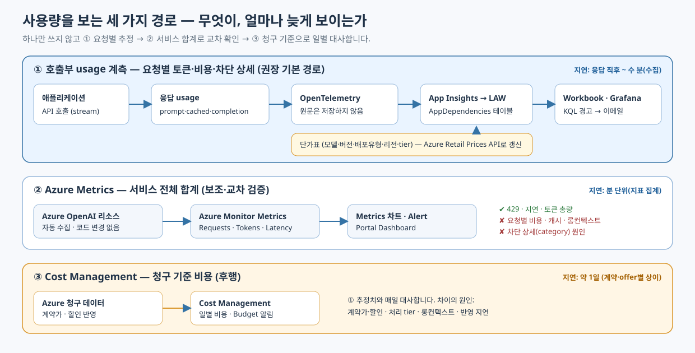
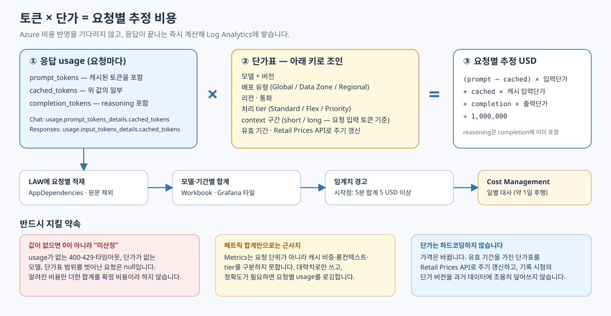
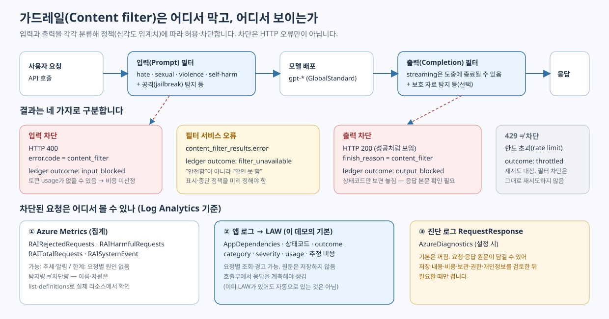
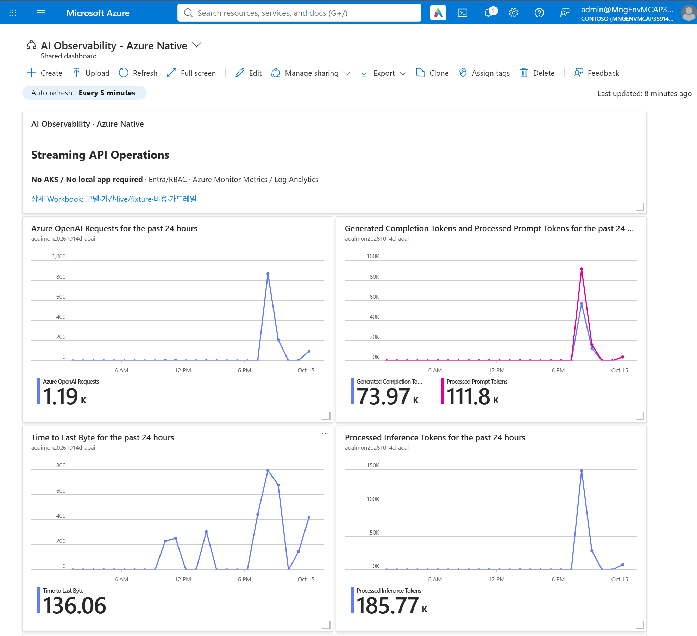
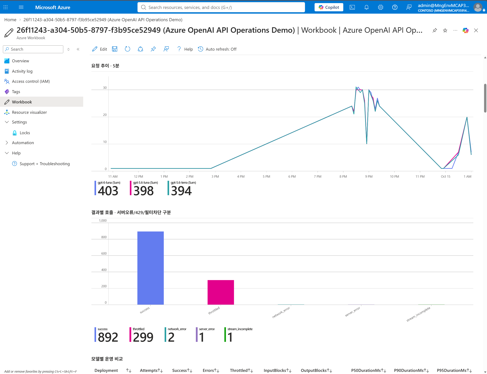
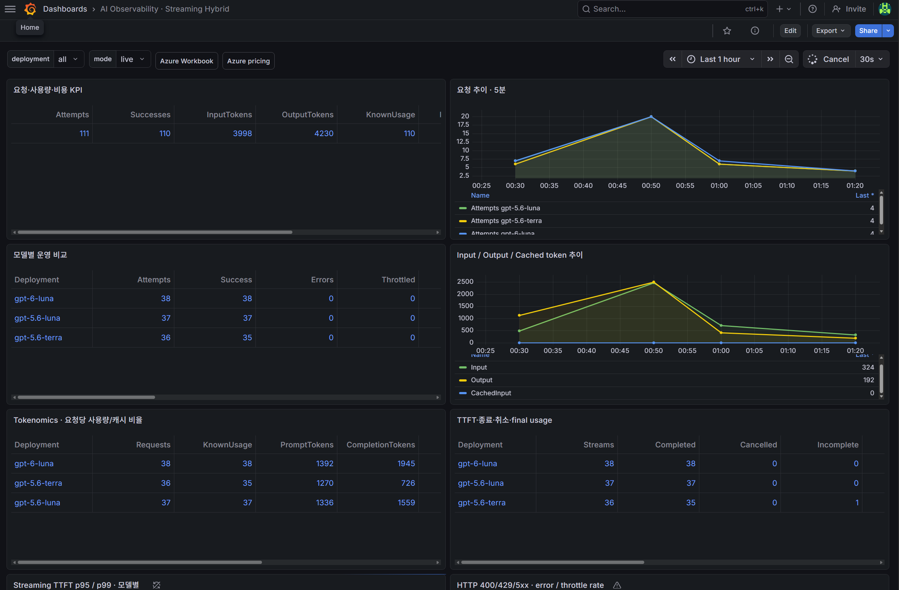

## 한눈에 보기

<!-- 문서 사이트(GitHub Pages)에서는 site-page 주석 마커를 기준으로 이 README를 탭별 페이지로 나눕니다. 규칙은 scripts/docs/prepare_site.py 참고. GitHub에서는 이 파일 하나로 읽힙니다. -->
<!-- site-link -->📖 **문서 사이트로 보기:** [Azure OpenAI 모니터링 가이드](https://daeungo1.github.io/ai-monitoring-govern/) — 검색과 탐색 메뉴가 있는 웹 문서입니다. 

Azure OpenAI를 API로 직접 호출(에이전트 기능 없이)하는 팀 가이드: 실제 Azure 환경에서 검증한 데모입니다.

* **얼마나 쓰고 있나?** 요청 수, 토큰, 지연, 429(한도 초과)를 어떤 메트릭으로 보고 언제 경고할지
* **얼마가 들고 있나?** Azure 비용은 늦게 보이므로, 토큰 사용량에 단가를 곱해 거의 실시간으로 추정하는 방법
* **안전한가?** 가드레일(Content Safety)이 무엇이고, 막힌 요청을 Log Analytics에서 볼 수 있는지

프롬프트·응답 원문과 API 키는 관측 데이터에 저장하지 않습니다.

## 고객 문의

이 저장소는 아래 두 가지 요건에 답하도록 구성했습니다.

> **1. 효율적인 AI 사용량 모니터링 구성**
>
> * **핵심 메트릭 가이드:** Azure Metrics 기반 모니터링 시 공식 문서만으로는 판단이 어려운 부분이 있어, 메트릭 설명 및 실질적으로 주시해야 하는 메트릭과 적절한 경고(Alert) 임계치 설정 기준 권장
> * **실시간 비용/토큰 모니터링 조언:** 현재 Azure의 토큰 사용 비용이 메트릭 반영에 시차가 있어(약 1일 소요), 메트릭의 토큰 사용량에 토큰 단가를 매핑·계산하여 모니터링하는 방안을 고려 중입니다. 이에 대해 추천할 만한 구성 방식이나 Best Practice 검토
> * **추가 추천 요청:** Azure OpenAI 서비스 운영 시 실무적으로 도움 될 만한 추가 모니터링/운영 팁 *(현재 API 모델 호출만 사용 중이며 에이전트 같은 기능은 사용하지 않음)*
>
> **2. Azure OpenAI 가드레일(Content Safety) 모니터링 및 설정**
>
> * 가드레일 개념에 대한 기초 설명 및 효과적인 설정 가이드
> * 가드레일에 의해 차단된 요청의 모니터링 가능 여부 확인 *(현재 Log Analytics로 로그를 수집 및 적재 중)*

| 요건 | 한 줄 답 | 자세히 |
| --- | --- | --- |
| 1-1. 핵심 메트릭과 경고 기준 | 요청 수·429·오류율·지연(p95)·토큰·추정 비용 6가지를 모델별로 보고, 시작 임계치는 15분·최소 20건·5%입니다. | [메트릭·경고 가이드](docs/monitoring-guide.md) |
| 1-2. 실시간 비용·토큰 | **응답의 usage × 단가표**로 요청마다 계산해 Log Analytics에 쌓습니다. 메트릭 × 단가는 근사치로만 씁니다. | [가격 문서](docs/pricing.md) |
| 1-3. 추가 운영 팁 | 429 backoff, 출력 토큰 상한, 월 Budget alert, 수집 지연·usage 확보율 경고, 모델 버전 관리 | [메트릭·경고 가이드](docs/monitoring-guide.md) |
| 2-1. 가드레일 개념·설정 | 입력과 출력을 각각 심각도 임계치(Medium부터)로 분류해 차단합니다. 두 방향 모두, 모든 배포에 연결합니다. | [Content Safety 문서](docs/content-safety.md) |
| 2-2. 차단 요청 조회 | **가능합니다.** 호출부 로그를 Log Analytics에 적재하면 요청별로 볼 수 있습니다. 기본 진단 로그만으로는 보장되지 않습니다. | [차단 KQL](queries/content-filter.kql) |

## 먼저 알아둘 용어

| 용어 | 뜻 |
| --- | --- |
| 메트릭(Metrics) | Azure가 자동으로 모으는 숫자 시계열입니다. 요청 수, 토큰 수 같은 합계입니다. |
| Log Analytics(LAW), KQL | 로그를 쌓아 두는 저장소와 그 조회 언어입니다. 요청 한 건 한 건을 조회할 수 있습니다. |
| usage | API 응답에 들어 있는 토큰 수(입력·캐시·출력)입니다. 비용 계산의 기준입니다. |
| 429 | 한도(quota, 분당 요청·토큰) 초과 응답입니다. 가드레일 차단과 다릅니다. |
| TTFT, p95 | 첫 글자가 보일 때까지의 시간, 요청의 95%가 이 시간 안에 끝난다는 값입니다. 평균과 다릅니다. |
| 가드레일(Content filter) | 입력과 출력을 분류해 정책에 따라 허용·차단하는 통제입니다. |

## 사용량을 보는 세 가지 경로



Azure Monitor 문서만 읽으면 “메트릭에 비용이 1일 늦게 반영된다”로 끝나 보이지만, 실제로는 **서로 다른 세 개의 시계**가 있습니다.
각 경로가 잘하는 일이 달라서 하나만 쓰지 않고 함께 씁니다.

| 경로 | 잘하는 일 | 못하는 일 | 늦게 보이는 정도 |
| --- | --- | --- | --- |
| ① 호출부 usage 계측 | 요청별 토큰·비용·차단 상세, 모델별 비용 | 계측하지 않은 호출자는 볼 수 없음 | 응답 직후 ~ 수 분(수집) |
| ② Azure Metrics | 서비스 전체 요청 수·429·지연·토큰 합계 | 요청별 비용·캐시·롱컨텍스트·차단 원인 | 분 단위 |
| ③ Cost Management | 청구 기준의 확정에 가까운 비용 | 실시간 감시 | 약 1일(계약·offer별로 다름) |

“약 1일 지연”은 모든 메트릭의 일반 특성이 아니라 **비용 데이터(③)의 특성**입니다. 현재 지연 경로를 확인하고
API usage와 수집 지연을 함께 측정하세요. 이 데모의 목표는 거의 실시간인 **운영 추정**이며 확정 청구나 비용 하드캡이 아닙니다.

## 요건 1. 효율적인 AI 사용량 모니터링

<!-- site-page: usage/metrics.md -->
### 1-1. 핵심 메트릭과 Alert 임계치

실제 리소스에서 `az monitor metrics list-definitions`로 이름·집계·차원을 먼저 확인하세요.
지원 여부는 SKU·클라우드·배포 유형에 따라 다르며, 정의가 있다는 것이 데이터가 채워진다는 뜻은 아닙니다.

| 신호 | 볼 곳 | 왜 보나 | Alert 시작점 |
| --- | --- | --- | --- |
| 서버·네트워크 오류율 | AzureOpenAIRequests(StatusCode 분할), 요청 로그 | 서비스 문제. 401/403은 설정 오류, 안전 차단은 분리 | 모델별 15분, 최소 20건, **5% 이상** |
| 429 비율 | AzureOpenAIRequests(StatusCode=429) | quota, 분당 한도, burst, 재시도 폭주 | 모델별 15분, 최소 20건, **5% 이상** |
| 총 소요 시간 p95 | 요청 로그의 DurationMs | 사용자 체감 지연 | 성공 호출, 모델별 15분, 최소 20건, **5초 초과** |
| 첫 응답 시간 p95 (streaming) | 요청 로그의 TTFT | 첫 글자가 늦게 뜨는 문제 | 모델별 15분, 최소 20개, **3초 초과** |
| 토큰 급증 | GeneratedTokens, ProcessedPromptTokens | 비용·quota 소진 징후 | 5분 GeneratedTokens **100,000 초과**(시연값) |
| 추정 비용 급증 | 요청 로그의 추정 비용 | 예상 밖 지출 | 5분 합계 **5 USD 이상** |
| 스트림 비정상 종료 | 요청 로그의 stream_incomplete | 종료 신호 누락·전송 오류 | live 15분 내 **3건 이상** |
| 필터 서비스 실패 | 요청 로그의 filter_unavailable | 안전 검사를 못 한 응답 | **1건 이상** |
| PTU 사용률 (PTU 사용 시) | AzureOpenAIProvisionedManagedUtilizationV2 | 용량 계획 | 80~90% 지속 증가. 이 데모는 PAYG라 해당 없음 |

위 값은 **시작점**이며 모든 고객에 맞는 고정값이 아닙니다. 2주 이상 정상 패턴과 peak 트래픽, 모델·리전·SKU, 고객 SLO에 맞춰 보정하세요.
표본이 적으면 비율 경고 대신 일정 기간의 절대 오류 건수나 지속 실패를 경고로 씁니다.

공식 문서만으로 판단하기 어려운 해석 주의점입니다.

* **TokenTransaction = 입력 + 출력**입니다. ProcessedPromptTokens, GeneratedTokens와 다시 더하면 이중 계산입니다.
* 일반 Cognitive Services의 `Latency`, `BlockedCalls`, `ClientErrors`는 Azure OpenAI 전용 지표가 아닙니다. 혼용하지 마세요.
* 메트릭의 평균 지연으로 **p95를 만들 수 없습니다.** p95는 요청별 DurationMs·TTFT 로그로 계산합니다.
* 진단 설정으로 내보낸 메트릭은 차원(모델 배포 등)이 평탄화될 수 있습니다. 모델별 분석은 Metrics API나 요청 로그로 하세요.
* 안전 관련 서비스 메트릭(RAI 계열)은 탐지량과 차단량이 다르고 분모가 다릅니다. 요청별 상세의 대체가 아닙니다.

<!-- site-page: usage/cost.md -->
### 1-2. 실시간 비용·토큰 모니터링



**권장 구성:** 응답이 끝나는 순간 **usage × 단가표**로 요청별 비용을 계산해 Log Analytics에 쌓고, 합계와 경고는 그 위에서 만듭니다.
Azure Cost Management는 일별로 대사하는 기준으로 둡니다.

```text
추정 USD = ((prompt − cached) × 입력단가 + cached × 캐시 입력단가 + completion × 출력단가) ÷ 1,000,000
```

“메트릭의 토큰 사용량 × 단가”는 분 단위 근사 집계로 쓸 수 있지만, 다음 이유로 **보조 수단**입니다.

| 단가에 영향을 주는 요소 | 영향 | 이 데모에서의 처리 |
| --- | --- | --- |
| 캐시 토큰 | 캐시 입력 단가는 일반 입력 단가의 1/10로 게시됩니다(예: 0.20 → 0.02 USD/1M). cached 토큰은 prompt에 **포함**되어 있으므로 빼고 계산합니다. | usage의 cached_tokens를 차감해 별도 단가 적용. 값이 없으면 전부 uncached로 계산한 상한 추정 |
| 캐시 쓰기 | Azure 가격표에 별도 meter가 있고 입력 단가의 1.25배로 게시되어 있습니다. | 구현하지 않음. 해당 토큰이 오면 **미산정** |
| 롱컨텍스트 | 요청 **1건의 입력 토큰 수**로 short/long이 정해집니다(출력 무관). 게시 단가는 long이 입력 2배·출력 1.5배입니다. 합산 메트릭으로는 어떤 요청이 해당하는지 알 수 없습니다. | prompt 4,096 토큰 이하만 단가 적용, 초과는 **미산정**. 임계 토큰 수는 모델별로 Azure 가격 페이지에서 확인 |
| Reasoning 토큰 | completion에 포함되어 출력 단가로 과금됩니다. | 별도 처리 없음(이중 합산 금지) |
| 배포 유형 | Global, Data Zone, Regional 단가가 다릅니다. Data Zone은 게시 단가에서 Global보다 약 10% 높았습니다. | 단가표 키에 포함. 데모는 GlobalStandard만 |
| 처리 모드 | Flex는 Standard의 50%, Priority는 2배로 게시됩니다. 응답의 `service_tier`로 구분합니다. | 기본 수식 밖(미지원). 사용한다면 service_tier를 로그에 남기고 단가를 분리 |

단가 수치는 2026-10-15에 조회한 Azure 게시 단가 기준입니다. 계약 가격과 다를 수 있으니 리전·배포 유형별로 확인하세요.

Best practice입니다.

1. **응답 usage를 기준으로 삼습니다.** streaming에서는 `stream_options.include_usage`로 마지막 chunk의 usage를 받습니다.
2. **단가를 코드에 박지 않습니다.** 모델 + 버전 + 배포 유형 + 리전 + tier + context 구간 + 유효 기간을 키로 한 단가표를 두고
   [Azure Retail Prices API](https://learn.microsoft.com/rest/api/cost-management/retail-prices/azure-retail-prices)로 주기 갱신합니다. 가격은 실제로 바뀝니다.
3. **모르면 0이 아니라 미산정(null)입니다.** usage가 없는 400·429·타임아웃, 단가가 없는 모델, 범위 밖 요청을 무료로 표시하지 않습니다.
4. **기록 시점의 단가 버전을 보존합니다.** 단가를 바꿔도 과거 데이터를 조용히 덮어쓰지 않습니다.
5. **추정과 청구를 분리해 표시하고 매일 대사합니다.** 차이는 계약가·할인·tier·롱컨텍스트·반영 지연에서 나옵니다.
6. **수집 지연과 usage 확보율도 감시합니다.** 비용 합계가 낮게 보이는 이유가 실제로 적게 쓴 것인지, 수집이 늦은 것인지 구분해야 합니다.
7. **여러 호출자가 계측을 우회하면** Azure Metrics가 전체 볼륨의 기준입니다. 공통 진입점(APIM 등)을 두면 계측 범위를 넓힐 수 있습니다.

<!-- site-page: usage/tips.md -->
### 1-3. 추가 운영 팁

* **Budget alert**를 월 단위로 별도 구성합니다. Budget은 자동 중단(하드캡)이 아닙니다.
* 성공·오류·차단, 논리 요청과 시도(attempt), **재시도를 분리**해 재시도 비용과 폭주를 봅니다.
* `max_completion_tokens` 상한과 동시성·대기열을 관리합니다. 출력 길이가 비용과 지연을 좌우합니다.
* **429**에는 `Retry-After`와 지수 backoff + jitter를 쓰고, **필터 차단은 그대로 재시도하지 않습니다.**
* 모델 버전을 고정하고 **retirement 공지**와 API version 호환성을 변경 관리에 넣습니다.
* 상시 운영에서는 **수집 지연**과 **usage 확보율** 경고를 추가합니다. 단발성 테스트에서 “트래픽 없음” 경고는 켜지 않습니다.
* 비용 ledger를 trace sampling에 의존시키지 않습니다. 샘플링하면 비용 합계가 틀어집니다.
* LAW의 일일 cap, 보존 기간, 접근 권한(RBAC), 수집 비용을 함께 모니터링합니다.
* 정상 입력 코호트로 가드레일 **오탐·누락과 한국어 품질**을 별도로 평가합니다.
* 로그에는 에러 객체 전체를 남기지 않습니다. SDK 에러 메시지에 사용자 원문이 섞일 수 있습니다.

## 요건 2. 가드레일(Content Safety)

<!-- site-page: guardrails/concept.md -->
### 2-1. 가드레일이란

생성 모델과는 별도로 **입력과 출력을 분류**해 정책에 따라 허용·차단하는 통제입니다.
Azure OpenAI의 내장 content filtering은 Azure AI Content Safety로 동작합니다.

* Hate, Sexual, Violence, Self-harm 네 범주에 대해 safe / low / medium / high 심각도를 판정합니다.
* 기본 **Medium 임계치**는 Medium과 High를 차단하고 Low와 Safe는 통과시킵니다.
* **입력(Prompt)과 출력(Completion)을 각각** 설정해야 합니다.
* 정확성 보장, 모든 prompt injection 방어, 모든 개인정보 제거를 보장하지 않습니다. system prompt만으로 대신할 수도 없습니다.



<!-- site-page: guardrails/setup.md -->
### 2-2. 효과적인 설정 가이드

1. **현재 정책부터 확인합니다.** 리소스에 실제 연결된 정책 이름을 확인하세요. 포털 메뉴 이름은 classic/new Foundry에 따라 다릅니다.
2. **입력·출력 모두, 네 범주 모두** enabled와 blocking을 켭니다. 이 데모의 정책(`demo-medium`)은 범주별로 Prompt·Completion에 Medium을 명시합니다.
3. **모든 모델 배포에 정책을 연결**합니다. 배포마다 정책 연결이 따로 필요합니다.
4. 시작 임계치는 **Medium**입니다. 업무 특성에 따라 조정하되, 낮추거나 끄는 구성은 제품 정책과 승인 제약을 먼저 확인하세요.
5. Prompt Shields(공격 탐지), 보호 자료 탐지 같은 추가 기능은 현재 지원 범위와 적용 대상을 확인한 뒤 켭니다.
6. **오탐이 나면** 범주·심각도와 정상 입력 코호트부터 분석합니다. 임계치를 풀기 전에 입력 맥락, 사용 목적, 개인정보, 사내 승인을 검토하세요.
   오탐을 줄이는 것이 곧 안전해지는 것은 아닙니다.
7. **필터 서비스가 실패했을 때**(`filter_unavailable`) 응답을 보여 줄지 막을지 미리 정합니다. “안전함”이 아니라 “확인하지 못함”입니다.
8. streaming에서는 일부 출력 뒤에 차단되거나 annotation이 늦게 올 수 있으므로 화면 동작을 함께 설계합니다.

<!-- site-page: guardrails/blocked-requests.md -->
### 2-3. 차단된 요청을 Log Analytics로 볼 수 있나

**볼 수 있습니다. 단, 로그가 어떻게 쌓이는지에 달려 있습니다.** Log Analytics를 쓴다고 해서 모든 차단 상세가 자동으로 수집되는 것은 아닙니다.

| 방법 | 볼 수 있는 것 | 한계 |
| --- | --- | --- |
| Azure Metrics (RAI 계열) | 차단·탐지 건수 추세와 경고 | 요청별 원인 없음. 탐지량 ≠ 차단량 |
| 호출부 로그 → LAW (이 데모의 기본) | 요청별 outcome, 범주·심각도, 상태코드, usage, 추정 비용 | 호출부에서 응답을 계측해야 함. 원문은 저장하지 않음 |
| 진단 로그 RequestResponse | 요청·응답 기록 | 기본 꺼짐. 원문이 담길 수 있어 저장 내용·비용·보관·권한·개인정보 검토 후에만 사용 |

차단은 HTTP 오류만이 아닙니다. **상태코드만 보면 출력 차단을 놓칩니다.**

| 결과 | API 증거 | 기록되는 outcome |
| --- | --- | --- |
| 입력 차단 | HTTP 400, `error.code = content_filter` | input_blocked |
| 출력 차단 | HTTP 200, `finish_reason = content_filter` 또는 filtered annotation | output_blocked |
| 필터 서비스 실패 | `content_filter_results.error` | filter_unavailable |
| 429 | 한도 초과 | throttled (차단이 아님) |

```kusto
AppDependencies
| where TimeGenerated > ago(24h)
| where Properties["telemetry.kind"] == "aoai.request" and Properties["demo.mode"] == "live"
| extend Outcome = tostring(Properties["aoai.outcome"]), Deployment = tostring(Properties["aoai.deployment"])
| where Outcome in ("input_blocked", "output_blocked", "filter_unavailable")
| summarize Requests = count() by Outcome, Deployment
```

이미 Log Analytics를 쓰고 계시다면 이 순서로 확인하세요: ① 진단 설정에서 어떤 category가 켜져 있는지
([진단 discovery KQL](queries/diagnostic-discovery.kql)) → ② AzureDiagnostics에 실제로 어떤 category가 들어오는지 →
③ 앱 로그에 outcome·category가 있는지. 상세 쿼리와 한계는 [Content Safety 문서](docs/content-safety.md)와 [차단 KQL](queries/content-filter.kql)에 있습니다.

<!-- site-page: ops/screens.md -->
## 세 가지 화면: 무엇을 쓸까

Azure에서 같은 데이터를 보는 화면이 세 가지입니다. 목적이 달라서 역할을 나눠 쓰는 것을 권장합니다.

### Shared Dashboard — 운영팀 요약 상황판



요청 수, 입력·출력 토큰, 마지막 byte까지의 시간, 총 추론 토큰 같은 **서비스 메트릭 타일을 고정**해 두는 첫 화면입니다.
자체 계산은 못 하므로 비용 같은 값은 Workbook 타일을 고정해 보여 줍니다. 추가 비용과 운영 부담이 가장 낮습니다.

### Workbook — 분석 화면



기간, 모델 배포, live/fixture, Run UUID를 바꿔 가며 요청 추이, 결과별 호출(성공·429·오류), 모델별 비교, 비용 추정, 차단 요청을 분석합니다.
KQL로 토큰 × 단가를 계산하고 가드레일 분석을 합니다. 무료입니다(로그 쿼리 비용만).

### Managed Grafana — 지속 관제 화면



배포별 분할과 풍부한 시각화, 멀티소스 관제가 필요할 때 씁니다. 모델별 비용을 Metrics 소스 분할과 곱셈으로 보고,
Grafana Alert로 계산된 비용에 직접 알림을 거는 구성도 가능합니다. 사용자 수 기준과 Standard 컴퓨트 요금이 들고 인스턴스·권한 관리가 필요합니다.

### 고객 질문별 비교

| 고객 질문 | Workbook | Shared Dashboard | Managed Grafana |
| --- | --- | --- | --- |
| 핵심 메트릭(요청·429·토큰·지연) | 가능 | 가능(차트 고정) | 가능, 시각화 가장 풍부 |
| 비용 추정(토큰 × 단가) | KQL로 계산 | 불가(Workbook 타일 고정) | KQL 또는 Transformation |
| 모델별 비용 구분 | 진단 설정 데이터로는 불가(차원 손실) | 원본에 따름 | **가능**(Metrics 소스 분할 + 곱셈) |
| 캐시·롱컨텍스트 반영 | 근사만 | 해당 없음 | 근사만 |
| 가드레일 차단 건수·범주 | 가능 | 가능(차트 고정) | 가능 |
| 차단 내용 파악 | 앱/APIM 로그가 있을 때만 | 동일 | 동일 |
| Alert 운영 | Azure Monitor Alert | Azure Monitor Alert | Grafana Alert 또는 Azure Monitor Alert |
| 비용 | 무료(로그 쿼리 비용만) | 무료 | 사용자 수 + Standard 컴퓨트 |
| 운영 부담 | 낮음 | 매우 낮음 | 중간 |

**최종 권장**

* **기본 구성(이 고객에 적합):** Workbook으로 분석 화면을 만들고, Shared Dashboard에 핵심 타일을 고정하고, 알림은 Azure Monitor Alert로 운영합니다. 추가 비용 없이 고객 질문 대부분을 커버합니다.
* **Managed Grafana로 넘어갈 시점:** 한 리소스에 여러 모델을 쓰면서 모델별 비용 알림까지 필요할 때, 또는 외부 시스템까지 통합 관제해야 할 때입니다.
* **공통 한계:** 차단된 단어 파악과 정확한 비용 계산(캐시·롱컨텍스트)은 **어떤 대시보드를 써도 메트릭만으로는 불가능**합니다. 앱이나 APIM에서 요청별 로그를 남겨야 합니다.

항목별 근거와 이 저장소에서 확인한 사실은 [화면 비교 상세](docs/dashboard.md)에 있습니다.

<!-- site-page: ops/architecture.md 구성과 검증 범위 -->
## 구성 한눈에 보기


호출부 OpenTelemetry → Application Insights → Log Analytics로 요청별 로그를 쌓고, Azure Monitor 네이티브 메트릭과 함께
Workbook·Shared Dashboard·Grafana와 Azure Monitor Alert(이메일)로 보여 줍니다. APIM, AKS, Langfuse, agent framework는 기본 구성에 필요하지 않습니다.
Cost Management 일별 대사는 운영 권장 설계이며 자동 대사 커넥터는 포함하지 않았습니다.

## 이 저장소가 검증한 것

* 세 모델(`gpt-6-luna`, `gpt-5.6-luna`, `gpt-5.6-terra`)을 별도 배포로 실제 streaming 호출하고, 모델별 usage·TTFT·종료 상태를 수집했습니다.
* 유해 문장 없는 fixture 27개로 입력 차단·출력 차단·429·필터 실패·취소 경로를 합성 검증했습니다. 실제 서비스 차단과는 구분됩니다.
* Workbook 21개 쿼리, Shared Dashboard, Managed Grafana를 조회 검증했고 7개 log alert와 1개 metric alert를 구성했습니다.
* 2026-10-14 지속 부하에서 호출 1,078건 중 776건이 성공했고 추정 비용은 약 0.39 USD였습니다. 429와 usage 누락 요청은 비용을 0으로 만들지 않고 미산정으로 남겼습니다.
  오늘의 수치와 읽는 법은 [일일 보고서](dailyreport.md)를 보세요.

검증했다고 주장하지 않는 것: 계약 단가, 실제 inbox 수신, harmful 입력에 대한 실제 차단율, production 보안 완료, 장기 benchmark.
상세는 [검증 기록](docs/validation.md)에 있습니다.

> [!IMPORTANT]
> 비용은 Azure 공개 단가(GlobalStandard · East US 2 · short context · USD per 1M · prompt 4,096 토큰 이하) 기반 **추정**이며 청구 비용이 아닙니다.
> 단가를 확인하지 못한 모델은 `unconfigured`이고 비용은 `null`입니다.
> 안전 필터 시연 fixture는 실제 Azure가 해당 입력을 차단했다는 증거가 아닙니다.
> 공개 웹 데모(Static Web App)에는 앱이 정한 비용·동시 실행 상한이 없습니다. Azure quota(429)와 실제 청구는 그대로 적용됩니다.

<!-- site-page: overview/documents.md 문서 지도 -->
## 문서

* [Azure OpenAI API 모니터링 운영 가이드와 실제 데모 증거](AOAI_monitoring.md)
* [메트릭, 토큰 비용, Alert 운영 가이드](docs/monitoring-guide.md)
* [Content Safety 설정과 차단 관측](docs/content-safety.md)
* [세 화면(Workbook·Shared Dashboard·Grafana) 비교와 선택](docs/dashboard.md)
* [공식 Azure 가격과 적용 범위](docs/pricing.md)
* [일일 보고서: 오늘의 측정값과 읽는 법](dailyreport.md)
* [표준 아키텍처와 보안 경계](docs/architecture.md)
* [AI Observability Governance](docs/governance.md)
* [Streaming 지표와 종료·취소 처리](docs/streaming.md)
* [참고 저장소·AgentOps issue 적용 판단](docs/agentops-dashboard-mapping.md)
* [Hybrid 배포와 현재 접근 상태](docs/hybrid-deployment.md)
* [실제 참고 저장소 Dashboard integration](docs/reference-dashboard.md)
* [15분 고객 데모 Runbook](docs/demo-runbook.md)
* [공개 웹 데모](apps/load-demo/web/README.md)
* [이메일 알림 시나리오](docs/alert-email.md)
* [검증 결과와 미검증 범위](docs/validation.md)
* [공식 출처와 기존 delivery 활용 기준](docs/references.md)

<!-- site-page: ops/quickstart.md 빠른 시작과 배포 -->
## 빠른 시작

Windows PowerShell 7, Node.js 22 이상, Azure CLI, Bicep가 필요합니다.
모든 명령은 저장소 루트에서 실행합니다. Azure CLI 인증은 `az login`으로 준비합니다.
권한은 리소스 생성 및 OpenAI 리소스 범위 RBAC 생성이 가능해야 합니다.
모델별 quota와 가용 버전은 배포 직전에 다시 확인합니다.

```powershell
npm ci
npm test
npm run demo:offline
```

Offline은 모델 호출·Azure export 없이 세 모델별 9개 fixture와 독립적인 비용 수학 예제를 실행합니다.

## Azure 배포와 시연

```powershell
# 먼저 validate와 what-if만 실행합니다.
.\scripts\Deploy-Demo.ps1 `
  -SubscriptionId "<subscription-guid>" `
  -ResourceGroupName "rg-aoai-monitor-demo" `
  -ResourcePrefix "<globallyuniqueprefix>" `
  -Location "eastus2"

# 검토 후 -Execute를 추가합니다. 실제 과금 리소스를 생성합니다.
.\scripts\Deploy-Demo.ps1 `
  -SubscriptionId "<subscription-guid>" `
  -ResourceGroupName "rg-aoai-monitor-demo" `
  -ResourcePrefix "<globallyuniqueprefix>" `
  -Location "eastus2" -Execute

.\scripts\Use-Demo.ps1 -Mode live -CountPerModel 1
.\scripts\Use-Demo.ps1 -Mode replay
```

각 실행의 마지막 줄에 출력되는 run UUID를 기록합니다.
메일 경로 시연은 배포 시 `-AlertEmail "<authorized-email>"`을 추가하고
`.\scripts\Test-AlertEmail.ps1 -EmailAddress "<authorized-email>"`로 한 번 테스트합니다.
수신자 인증, Azure 발송 결과, 실제 inbox 수신을 별도 확인합니다.

```powershell
.\scripts\Use-Demo.ps1 -Mode verify `
  -LiveRunId "<live-run-uuid>" -ReplayRunId "<replay-run-uuid>" `
  -CountPerModel 1
```

모델 하나만 실행하려면 `-Deployments "gpt-5.6-terra"`를 추가하고 verify에도 같은 선택을 적용합니다.
단일 실행에서 같은 safe counting 메시지와 출력 상한으로 모델들을 streaming 순차 호출합니다.
작은 smoke test의 지연값은 모델 품질/성능 벤치마크가 아닙니다.

관측은 Azure Portal의 Shared Dashboard와 Workbook에서 시작합니다. [화면 링크와 사용법](docs/dashboard.md)을 확인하십시오.
native 화면을 위한 로컬 서버는 필요하지 않습니다.
Managed Grafana와 참고 저장소 Dashboard는 Hybrid 비교 경로입니다.
참고 저장소의 실제 React/Fastify 코드는 [integration](integrations/foundry-dashboard)에 포함했습니다.
MIT license와 upstream commit을 보존하고 API-only LAW adapter, streaming/ledger와 null 비용을 반영했습니다.
Native/Grafana는 배포·조회 검증됐지만 custom UI의 Azure 호스팅은 Microsoft Graph 재인증에
막혀 있습니다. 인증을 끈 공개 호스팅으로 우회하지 않았습니다.

<!-- site-page: ops/maintenance.md 가격 갱신·설정·정리 -->
## 공식 가격 갱신

| 모델 | Input | Cached input | Output | Cache write |
| --- | --- | --- | --- | --- |
| gpt-6-luna | $0.10 | $0.01 | $0.50 | $0.125 |
| gpt-5.6-luna | $0.20 | $0.02 | $1.20 | $0.25 |
| gpt-5.6-terra | $2.00 | $0.20 | $12.00 | $2.50 |

단위는 USD per 1M tokens, East US 2 / Global Standard / Short context입니다.
Cache write meter는 기록하되 현재 driver의 별도 cache-write billing은 구현하지 않습니다.
cache-write token이 반환되면 기본 input 수식으로 숨겨 계산하지 않고 unknown으로 처리합니다.

```powershell
npm run prices:refresh
npm run monitoring:build
```

API meter 약어(`ShortCo / Inp / Cd Inp / Cd Wr / Opt / Std Gl`)와 공식 HTML `data-amount`를
대조합니다. [가격 증거](config/azure-price-evidence.json)에 출처와 확인일이 저장됩니다.
Workbook에는 과거 null cost의 current snapshot 재계산과 원래 기록 cost를 별도로 표시합니다.

## 설정과 데이터

* [모델 설정](config/models.json)은 배포명, 실제 모델명, 버전, SKU, quota capacity의 단일 기준입니다.
* [모델별 단가](config/model-prices.json)는 실제 호출 비용 계산용입니다.
* [Managed Grafana IaC](infra/managed-grafana.bicep)와 [Hybrid web hosting IaC](infra/hybrid-web.bicep)는 추가 표면입니다.
* [독립적인 단가 예제](config/prices.json)는 비용 수식 시연에만 사용합니다.
* [KQL](queries)은 고객이 기존 Log Analytics에 맞춰 가져갈 수 있습니다.
* [Bicep](infra/main.bicep)은 별도 리소스 그룹을 포함해 구독 범위로 배포합니다.
* [테스트](tests)는 원문 없는 응답 envelope, 캐시 계산, 누락 usage, 단가와 모델 선택을 검증합니다.

실행 결과와 설정은 git 제외된 `artifacts` 디렉터리에 저장합니다.
Application Insights connection string은 실행 프로세스에만 로드합니다.
기본 샘플은 Entra user 인증이고 API key 인증은 비활성화합니다.

## 비용과 정리

모델 PAYG 호출, Log Analytics 수집, 7개 log alert와 1개 metric alert 평가에 비용이 발생할 수 있습니다.
Managed Grafana Standard는 node 약 25 USD/730h + active user 약 6 USD/월입니다.
Reference Dashboard를 Azure Linux B1에 호스팅하면 약 12.41 USD/730h가 추가됩니다.
실제 계약/세금/LAW/모델 사용량은 별도이며 상세 출처는 가격 문서에 있습니다.
Workbook만 표시한다고 추가 hosted compute가 생기지는 않습니다.
LAW의 1 GB/day cap은 비용 제한의 보조 장치이며 청구 hard cap도 수집 보장도 아닙니다.
AlertEmail을 지정하지 않으면 규칙은 생성되지만 email 알림 수신자는 없습니다.

데모 종료 후 별도 리소스 그룹의 이름과 구독을 확인하고 삭제합니다.
다른 고객/운영 리소스 그룹에는 실행하지 마십시오.

```powershell
az group delete --subscription "<subscription-guid>" `
  --name "rg-aoai-monitor-demo" --yes --no-wait
```

GitHub 원격 저장소 생성, push, CI/CD 자동 배포는 수행하지 않습니다.
공개 전에는 문서의 환경 식별자와 `artifacts`, `.env`, credential 파일 제외 여부를 검토합니다.
