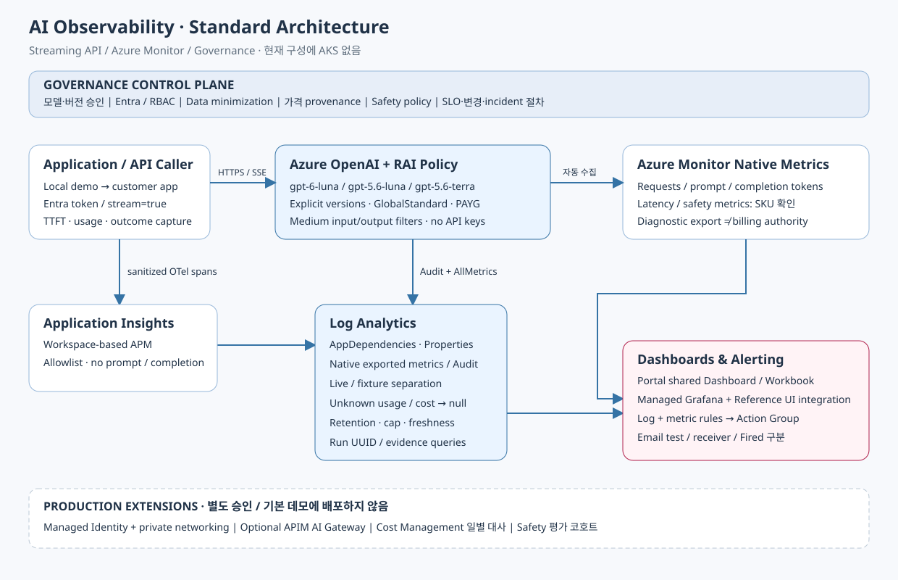

## 수집 계층을 분리하는 이유

[Governance 표준](governance.md)과 [Streaming 데이터 계약](streaming.md)을 함께 적용합니다.
현재 구현은 AKS를 사용하지 않습니다.

| 계층 | 목적 | 신뢰 경계 |
| --- | --- | --- |
| Azure OpenAI native metrics | 모든 호출자의 서비스 요청/토큰/지연 집계 | 앱 instrumentation 없이 수집, SKU별 지원 확인 |
| 진단 설정 | 리소스 Audit, export 가능한 metrics를 LAW로 전송 | 테이블/카테고리를 실제 리소스에서 확인 |
| 호출부 OTel ledger | 모델·usage·filter outcome·추정 비용의 요청별 상관관계 | 계측한 호출만 포함, 청구의 단일 진실 아님 |
| Application Insights + LAW | 표준 APM 저장소, KQL, Workbook, log alert | 수집 지연, daily cap, 권한, 보존 정책 |
| Cost Management/청구 | 실제 사용 비용의 후행 대사 | 분 단위 토큰 관측과 별도 처리 |

네이티브 Metrics의 분 단위 집계를 약 하루의 청구 반영 지연과 혼동하지 않습니다.
고객이 느끼는 하루 지연이 Cost Management, diagnostic export, dashboard refresh 중
어느 경로에서 발생하는지 먼저 확인합니다.

## 다중 모델

[모델 설정](../config/models.json)이 IaC와 호출부의 공통 기준입니다.
현재 대상은 다음 세 모델입니다.

| 배포명/모델 | 버전 | SKU | 용도 |
| --- | --- | --- | --- |
| gpt-6-luna | 2026-09-22 | GlobalStandard | 동일 API 호출 조건 비교 |
| gpt-5.6-luna | 2026-07-09 | GlobalStandard | 동일 API 호출 조건 비교 |
| gpt-5.6-terra | 2026-07-09 | GlobalStandard | 동일 API 호출 조건 비교 |

카탈로그 목록에 있다고 신규 배포가 가능한 것은 아닙니다.
실제 ARM preflight, 모델 lifecycle, SKU, 버전, quota를 함께 확인합니다.
가용하지 않은 모델은 선택 오류로 중단하며 조용한 fallback을 하지 않습니다.
`NoAutoUpgrade`로 비교 버전을 고정하지만 retirement 이전에는 계획적인 업그레이드가 필요합니다.
GlobalStandard는 리소스의 지역에만 inference를 한정하지 않습니다.
데이터 레지던시가 필요하면 DataZone/Regional SKU와 사내 정책을 별도로 평가합니다.

## 최소 배포

* 별도 demo resource group.
* OpenAI S0 리소스와 모델별 PAYG deployment.
* 4가지 harm category의 입력/출력 Medium RAI policy.
* workspace-based Application Insights와 LAW PerGB2018, 보존 30일.
* Audit + AllMetrics diagnostic setting.
* Portal native shared Dashboard, 상세 Workbook, log alert 7개, native metric alert 1개, Action Group.
* Hybrid 비교용 Managed Grafana와 Azure 호스팅용 참고 저장소 integration, 각각 상태는 검증 문서 기준.
* 호출자의 OpenAI User 역할을 OpenAI 리소스 범위로 제한.

외부 Content Safety 별도 리소스는 기본 OpenAI 내장 필터 관측을 위해 필요하지 않습니다.
사전 분류, 별도 text/image moderation 등의 요구가 있으면 별도 API로 추가할 수 있습니다.

## 보안과 프라이버시

OpenAI `disableLocalAuth=true`로 API key를 사용하지 않습니다.
개발용 CLI는 명확한 Azure CLI identity를 사용합니다.
운영 서비스로 옮길 때는 Managed Identity 또는 Workload Identity로 교체합니다.

OTel은 수동 allowlist 방식입니다. 요청 원문, 응답 원문, exception.message/stack,
사용자 식별자, SDK 전체 응답, HTTP body를 수집하지 않습니다.
필터 annotation도 category/severity/filtered/detected만 보존합니다.
기본 진단 설정은 RequestResponse/Trace 등의 원문 노출 위험 카테고리를 켜지 않습니다.

데모는 로컬 호출이 가능하도록 public endpoint를 사용합니다.
이는 production reference의 네트워크 보안 완료를 뜻하지 않습니다.
운영 배포에는 private endpoint, 접근 제어, private DNS, LAW/App Insights ingestion·query
접근, Entra 권한 분리, 보존·수집 규칙 검토가 추가로 필요합니다.

## 요청 ledger와 한계

OTel CLIENT span 한 개가 API attempt 한 개입니다.
SDK 자동 retry는 `maxRetries=0`으로 끄고 의도치 않은 이중 계산을 방지합니다.
운영에서는 retry attempt와 논리적 사용자 요청 ID를 별도로 추적하십시오.
timeout 후 서버가 처리했을 수 있으므로 client failure를 무과금으로 판단하지 않습니다.

데모는 streaming Chat Completions를 사용합니다.
Client visible TTFT와 전체 stream duration을 따로 수집합니다.
final usage, 취소/incomplete와 부분 출력 필터 상태를 구분합니다.
chunk 간 latency는 token 간 latency가 아닙니다.
실제 취소 부하와 비동기 safety filtering UX는 production 코호트로 추가 검증해야 합니다.

Export 성공은 LAW query 가능을 보장하지 않습니다.
검증은 실제 run UUID로 수집된 행, 모델별 성공 수, 누락 usage 처리,
원문 키 부재와 Workbook KQL 실행을 확인합니다.

## 선택하지 않은 구성

| 대안 | 선택하지 않은 이유 | 추가할 시점 |
| --- | --- | --- |
| native metrics만 | 요청별 비용·안전 결과의 상관관계 부족 | 빠른 초기 서비스 상태만 필요할 때 |
| APIM AI Gateway | 한 고객의 간단한 API 관측 데모에는 필수 아님 | 여러 호출자의 인증·quota·공통 정책 중앙화 |
| Langfuse/AKS | 이번 API-only 관측에 불필요 | 기존 해당 운영 플랫폼과 통합할 때 |
| agent tracing/evaluation | 고객이 agents를 사용하지 않음 | 향후 agent/tool workflow를 도입할 때 |

기존 delivery의 OTel 기반 상관관계와 비동기 evaluation 분리 원칙을 유지하되,
agent/교사-학생 그래프와 Kubernetes 구성은 기본 데모에서 제거했습니다.
Managed Grafana는 사용자 요청에 따라 Hybrid 확장으로 추가했습니다.
