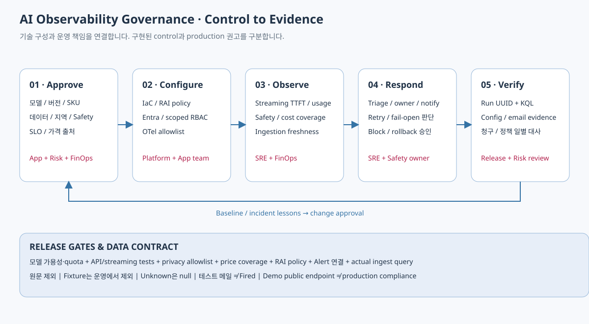

## 표준과 적용 범위

고객의 API-only streaming workload를 대상으로 합니다.
AKS는 현재 구성에서 제외합니다. 애플리케이션 호스팅 방식과 무관하게
Azure OpenAI native metrics와 원문 없는 호출부 ledger를 공통 관측 계약으로 사용합니다.
이 기준은 조직 Governance의 출발점이며 규제 compliance 인증을 의미하지 않습니다.

## 통제 카탈로그

| 영역 / control | 기준 | 현재 데모 | Production 책임 |
| --- | --- | --- | --- |
| 모델 inventory | deployment/model/version/SKU/region/owner 승인 | config/models + NoAutoUpgrade + quota preflight | 모델 변경과 retirement 계획 승인 |
| 호출 identity | Entra, API key 비활성화, 리소스 scope 권한 | OpenAI User, CLI identity, disableLocalAuth | Managed Identity/Workload Identity와 권한 정기 검토 |
| 데이터 레지던시 | Global/DataZone/Regional SKU의 경계 승인 | GlobalStandard를 명시 | Risk/Data owner가 지역 정책 승인 |
| 네트워크 경계 | private 접근과 ingress 제한 검토 | 로컬 demo public endpoint | private endpoint/DNS/Monitor 접근 구성 |
| 개인정보 최소화 | 원문·사용자 식별자·에러 body 제외 | allowlist + privacy tests | 예외 수집 승인·보존·접근 감사 |
| 비용 계약 | model/version/SKU/currency/effective dates | 공식 Azure retail 단가·meter 증거, 미확인 범위 null | FinOps 계약 단가 확인과 일별 대사 |
| 운영/합성 데이터 | live/fixture 분리 | dashboard, Workbook, Alert KQL에서 분리 | 운영 저장소/권한 분리 필요성 평가 |
| 가드레일 정책 | Prompt/Completion 임계치 각각 승인 | Medium policy 연결/read-back | 오탐/누락 코호트와 변경 승인 |
| Safety coverage | annotation 누락을 safe로 판단하지 않음 | coverage 별도 표시 | 미반환/필터 실패의 UI 표시/중단 결정 |
| Streaming 계약 | TTFT/종료/취소/usage를 요청별 기록 | streaming collector와 단위/실호출 검증 | 긴 응답, client cancellation, 부하 및 네트워크 평가 |
| SLO | 모델·경로·token 길이별 baseline | sample 최소 표본 + 시작 임계치 | 2주 이상 baseline과 business SLO 합의 |
| Alert ownership | rule/action/receiver/runbook 연결 | email recipient + Common Alert Schema + test | on-call/processing rule/notification 운영 |
| 수집 신뢰성 | ingestion lag/coverage/cap 확인 | KQL + coverage + flush 실패 표시 | continuous no-telemetry 알림과 cap 회피 |
| Release evidence | preflight/what-if/API/ingest/privacy/query | run UUID + 실제 LAW query | 승인자와 변경 기록/rollback 보관 |

표의 production 권고를 데모가 구현했다고 보고하지 않습니다.
현재 계정이 구독 관리자이면 demo 리소스에 추가한 scoped 역할만으로 계정 전체가
최소 권한으로 축소되는 것은 아닙니다.

## RACI

A는 최종 책임, R은 수행, C는 협의, I는 통보입니다.

| 업무 | App owner | Platform | SRE | Safety/Risk | FinOps |
| --- | --- | --- | --- | --- | --- |
| 모델/버전·응답 UX | A/R | C | C | C | I |
| IaC·identity·network·LAW | C | A/R | C | C | I |
| 계측·streaming data contract | A/R | C | R | C | C |
| content policy·fail-open 결정 | R | C | C | A/R | I |
| 단가·청구 reconciliation | C | I | C | I | A/R |
| SLO·Alert·incident triage | A | C | R | C | C |
| 데이터 수집 예외/원문 조사 | R | C | C | A | I |
| Production release gate | A | R | R | C | C |

알림 수신자는 on-call 수행자를 의미할 뿐 Safety 정책이나 과금 책임을 자동으로 대체하지 않습니다.

## 데이터 계약

요청 attempt 하나당 sanitized OTel span 하나입니다.

* correlation: run UUID, deployment, model/version/SKU, mode.
* performance: request start→first chunk, visible TTFT, stream duration, content chunk gap.
* reliability: HTTP 상태, outcome, terminal finish 관측, cancellation/incomplete.
* accounting: prompt/completion/cached counts, final usage known, nullable USD, price provenance.
* safety: source/category/severity/filtered/detected와 annotation observed.

Prompt/completion text, user identifier, bearer token, API key, raw exception/SDK response는 금지합니다.
reasoning 내용이나 chunk text도 보관하지 않습니다.
개별 input/output token 수는 usage 확인 시에만 known입니다.
unknown/null을 0이나 safe verdict로 치환하지 않습니다.

## Identity와 권한 분리

| 주체 | 최소 업무 권한 방향 |
| --- | --- |
| API 실행 앱 | OpenAI 리소스의 Cognitive Services OpenAI User |
| Dashboard/SRE | LAW query 및 Monitor resource read, 모델 호출 불필요 |
| 배포 담당 | 대상 RG 리소스 배포 및 scoped role assignment 권한 |
| FinOps | 관련 scope Cost Management Reader와 단가 관리 |
| Safety 조사자 | 승인된 annotation/incident record, 원문 저장소는 별도 권한 |

실제 역할 선택은 조직의 resource-context/workspace-context 접근 정책과 데이터 분리
요구에 따라 조정합니다. Native Workbook/Portal은 사용자 Entra session과 RBAC를 사용하고,
Managed Grafana/custom Azure hosting은 Managed Identity를 사용합니다.
폐기한 localhost Dashboard의 desktop credential에 운영 조회를 의존하지 않습니다.

## 운영 cadence와 변경 gate

| 주기 / 이벤트 | 필수 검토 | 산출물 |
| --- | --- | --- |
| 배포 전 | 모델/SKU/quota, RAI policy, price provenance, telemetry/privacy tests | preflight/what-if/API 검증 |
| 배포 후 | 실제 ingest, 모델별 run count, final usage, TTFT, safety coverage | LAW query evidence |
| 일별 | 토큰/추정 비용/청구 대사, 429, 오류, 필터 실패 | FinOps/SRE exceptions |
| 주별 | SLO baseline, 오탐, cancellation, unknown usage, ingestion lag | 임계치·정책 개선 제안 |
| 월별 | RBAC, 수집/보존 비용, model retirement, data residency | 운영 변경 승인 |
| Incident | scope/model/outcome/token 길이/원문 없는 annotation 확인 | owner 대응/rollback/사후 리뷰 |

가격·모델·RAI 임계치·수집 schema 변경은 PR 검토와 release evidence를 요구합니다.
Emergency rollback도 기존 정책/버전의 승인 상태와 데이터 레지던시를 유지해야 합니다.
Quota/SKU/region 변경은 단순 retry로 숨기지 않고 변경 사유를 기록합니다.

## Incident 의사결정

1. 401/403: identity/role/전파 조사, 안전 차단과 구분.
2. 429: burst/RPM/TPM/retry 검사, Retry-After/backoff/jitter로 제어.
3. TTFT/p95 상승: 모델/version/token 길이·인증·network와 service latency를 대조.
4. stream incomplete: 사용자 취소 여부와 transport 실패를 분리, usage 누락 비용은 unknown.
5. safety block: 정책/업무 오탐 검토, 차단 요청의 무조건 retry 금지.
6. filter_unavailable 또는 annotation 미반환: 표시/중단 정책에 따라 처리,
   원문을 로그에 붙여 넣지 않고 Risk owner에게 escalation.
7. 비용/수집 coverage 하락: 단가 key/버전, exporter, daily cap, bypass 호출 조사.

## Demo와 production의 경계

이 저장소는 운영 Governance를 설명하고 재현하는 데모입니다.
필터/취소/중단 fixture는 실제 악성 요청 시험이 아닙니다.
테스트 notification은 Azure 발송 경로 증거이지 Alert rule Fired 이력이 아닙니다.
청구 대사 connector, production networking, 자동 budget 차단, safety 품질 평가와
장기 SLO benchmark는 기본 배포에 포함하지 않습니다.
