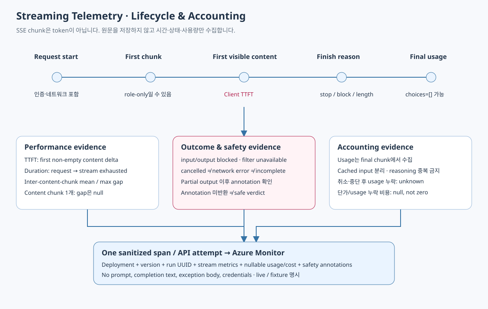

## 기본 호출 계약

Chat Completions `stream=true`, `stream_options.include_usage=true`로 호출합니다.
SDK retry는 0이며 attempt별로 한 span을 기록합니다.
chunk의 delta text는 화면/로그에 출력하지 않고 비어 있지 않은 content의 도착 시간만 측정합니다.
마지막 usage chunk는 finish_reason 이후 `choices=[]`로 올 수 있으므로 스트림을 끝까지 읽습니다.

## 지표 사전

| 지표 / attribute | 정의 | null 의미 |
| --- | --- | --- |
| aoai.first_chunk_ms | request start→첫 SSE chunk | 서비스가 stream을 시작하지 않음 |
| aoai.ttft_ms | request start→첫 non-empty visible content delta | visible content가 오지 않음 |
| aoai.stream_duration_ms | request start→iteration 종료/실패/취소 | 반드시 duration 기록 |
| aoai.inter_chunk_mean_ms | 연속 visible content chunk 간 평균 gap | content chunk가 1개 이하 |
| aoai.inter_chunk_max_ms | 연속 visible content chunk 간 최대 gap | content chunk가 1개 이하 |
| aoai.chunk_count | role/annotation/usage 포함 SSE chunk 개수 | token 개수가 아님 |
| aoai.content_chunk_count | visible content가 있는 chunk 개수 | output token 개수가 아님 |
| aoai.stream_completed | terminal finish와 transport 종료를 관측 | business 성공/안전 허용과 별개 |
| usage_known | prompt/completion의 final usage를 확보 | 취소/중단이면 누락 가능 |
| cost_known | usage + 유효 가격으로 추정 가능 | usage/단가 미설정이면 false |

Client TTFT는 credential 획득, network와 service 시간을 포함합니다.
역할-only chunk, reasoning-only delta, 빈 text는 visible TTFT로 계산하지 않습니다.
chunk가 여러 token을 묶을 수 있으므로 chunk gap을 TPOT/TBT라고 명명하지 않습니다.
native normalized TBT/TTFT는 Azure 서비스 정의 및 SKU 지원 범위를 따르는 별도 지표입니다.

## Outcome 처리

* terminal 없는 iteration 종료: `stream_incomplete`, success 아님.
* explicit client cancellation: `stream_cancelled`, network error와 별개.
* transport failure: `network_error`, 이미 받은 usage는 버리지 않음.
* stream 시작 전 content_filter: `input_blocked`.
* partial output 이후 content_filter: `output_blocked`.
* filter annotation의 service error: `filter_unavailable`.
* annotation 미반환: filterObserved=false, 안전 판정 아님.

비동기 필터 annotation과 partial output의 UX/중단 정책은 Risk와 App owner가 결정합니다.
이 데모는 원문을 보여 주지 않으며 서비스 필터 지연/보안 품질 자체를 보장하지 않습니다.

## Dashboard와 Alert

기간/모델별 TTFT p50/p95, full-duration p95, content chunk gap,
stream count/completed/cancelled/incomplete와 final usage coverage를 표시합니다.
모델별 p95들을 평균 내서 전체 p95라고 표시하지 않습니다.
관측한 요청 수가 적을 때는 benchmark/SLO 결과로 해석하지 않습니다.

TTFT 경고의 시작점은 모델별 15분/최소 20개 observable TTFT/p95 3초 초과입니다.
stream incomplete는 별도 관측하되 실제 사용 환경의 취소율과 전송 실패를 baseline으로 튜닝합니다.
first-byte/native service latency와 client latency를 대조합니다.

## 테스트와 한계

세 모델의 actual streaming 요청으로 terminal, TTFT, final usage를 검증합니다.
취소/incomplete/filter failure는 안전한 fixture로 관측 경로와 collector를 검증합니다.
실제 네트워크 단절, 대규모 부하, 긴 응답, gateway buffering, tokenizer 기반 TPOT,
실제 사용자 abort 부하와 비동기 필터 품질은 별도 production 검증이 필요합니다.
