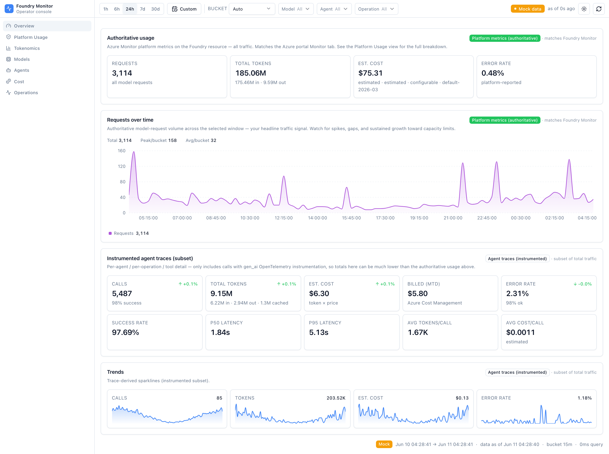
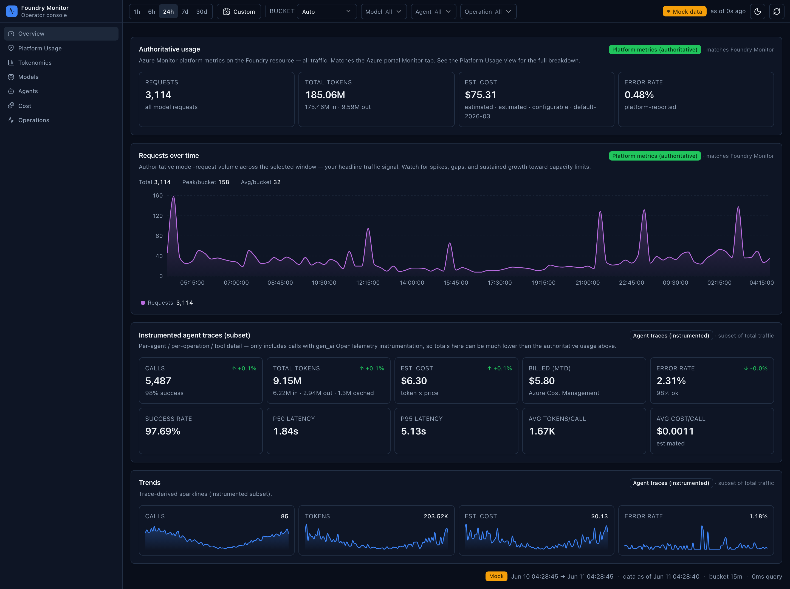
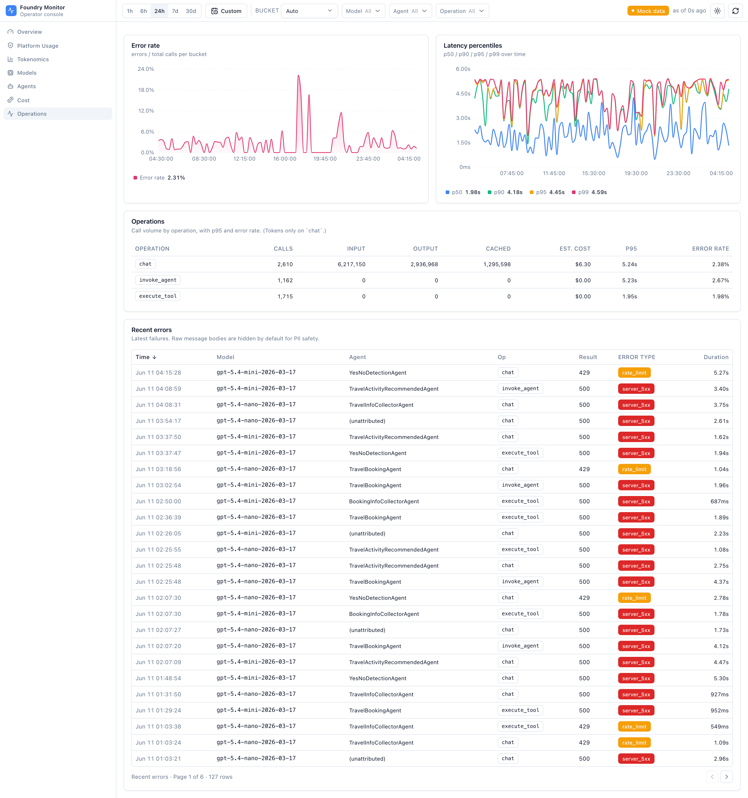
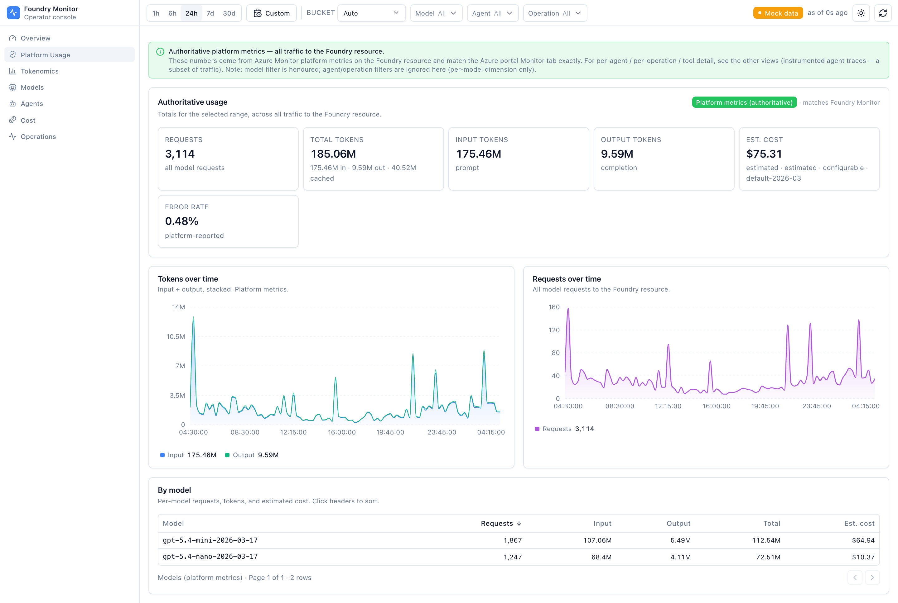
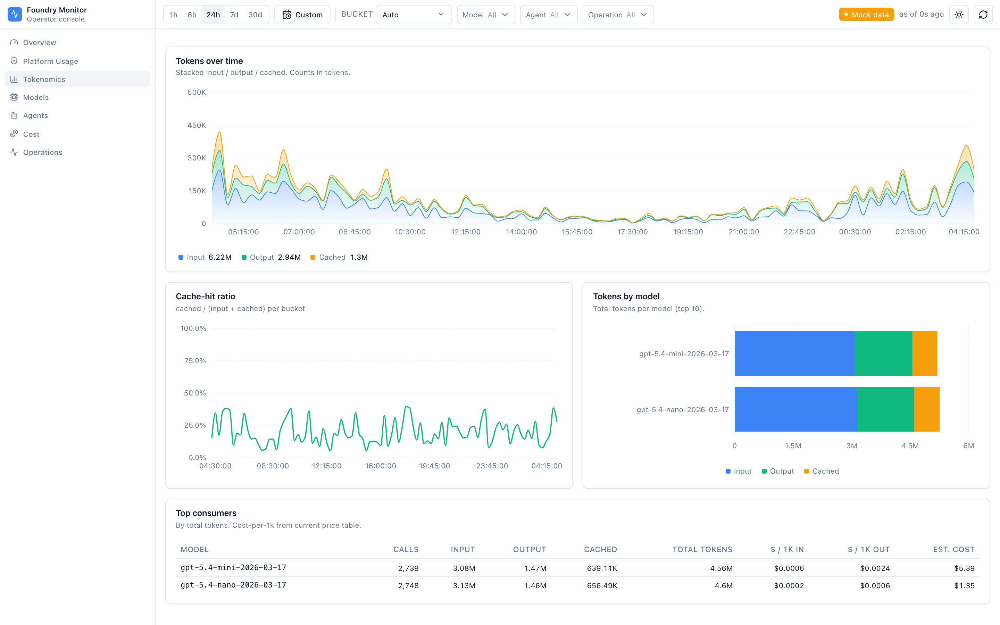
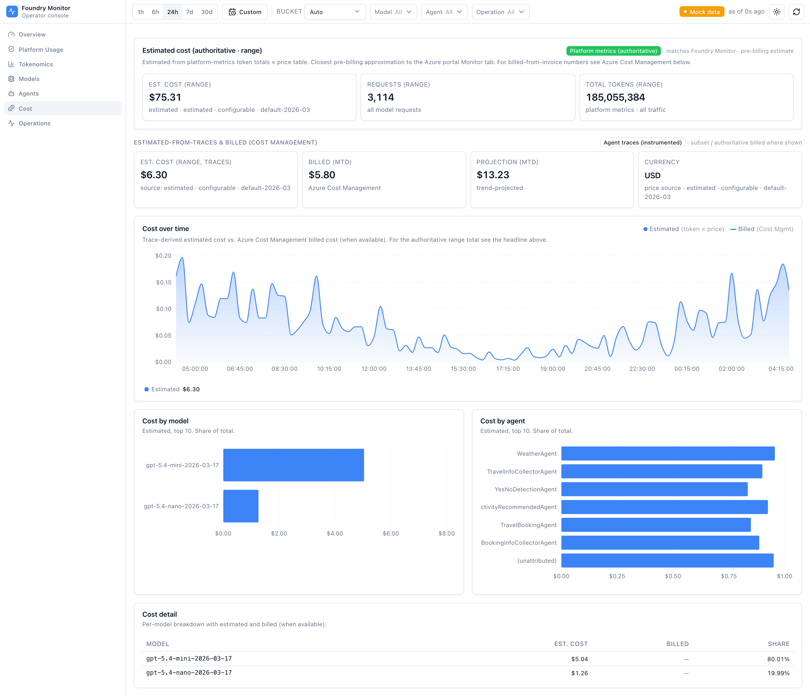
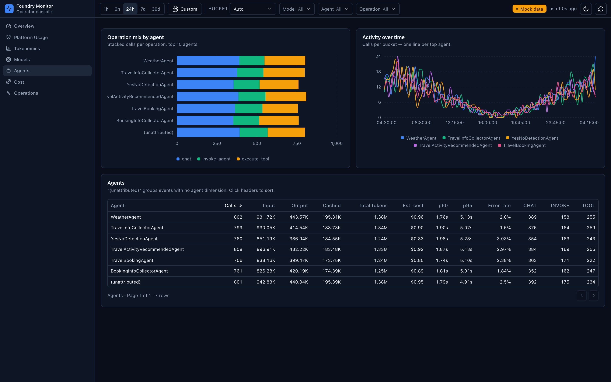
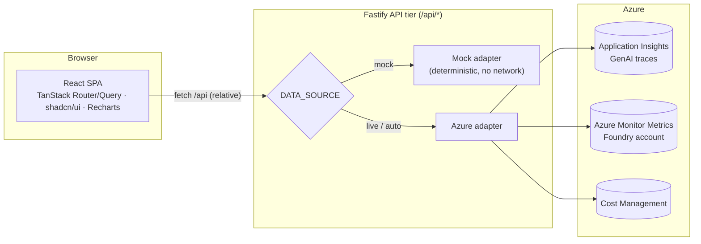

# Foundry Monitor Dashboard

A responsive monitoring dashboard for **Microsoft / Azure AI Foundry** telemetry — track requests, tokens (input / output / cached), latency, errors, and cost across your agents and models, with light/dark themes, preset and custom time ranges, and detailed per‑series chart legends.

It ships with a built‑in **mock data source**, so you can run the whole app locally or in Docker **with zero Azure setup** and explore every screen. Point it at real Azure data whenever you're ready.

## Screenshots

> **About these screenshots:** they were captured in **mock‑data mode** (`DATA_SOURCE=mock`) on purpose — so anyone can reproduce them without Azure, and so this public repo never exposes real telemetry. With Azure configured (`DATA_SOURCE=auto` or `live` + `az login`), the **same views render your live data** and the badge reflects the live source instead of "Mock data". See [Connecting live Azure data](#7-connecting-live-azure-data).

### Overview

Operator console with authoritative KPIs, a requests‑over‑time chart, instrumented‑trace metrics, and trend sparklines.



Light and dark themes follow your system preference or a manual toggle:



### Operations — latency & errors

Error‑rate trend, p50/p90/p95/p99 latency percentiles with detailed legends, a per‑operation breakdown, and a recent‑errors table (raw bodies hidden by default for PII safety).



### Platform usage

Authoritative requests and tokens over time that match the Foundry portal Monitor tab.



### Tokenomics

Input / output / cached token trends and cache‑hit behaviour.



### Cost

Estimated (token × price) and, where available, authoritative Cost Management figures.



### Agents (dark theme)

Per‑agent activity and usage tables.



---

## Table of contents

- [Screenshots](#screenshots)

1. [What you get](#1-what-you-get)
2. [Architecture](#2-architecture)
3. [Prerequisites](#3-prerequisites)
4. [Quick start A — Docker (mock data, fastest)](#4-quick-start-a--docker-mock-data-fastest)
5. [Quick start B — Local development](#5-quick-start-b--local-development)
6. [Production‑style local run (no Docker)](#6-production-style-local-run-no-docker)
7. [Connecting live Azure data](#7-connecting-live-azure-data)
8. [Configuration reference (environment variables)](#8-configuration-reference-environment-variables)
9. [npm scripts](#9-npm-scripts)
10. [Project structure](#10-project-structure)
11. [Security notes](#11-security-notes)
12. [Troubleshooting](#12-troubleshooting)
13. [Development & quality gates](#13-development--quality-gates)

---

## 1. What you get

- **Overview** (`/`) — headline KPIs, authoritative usage band, and a "Requests over time" panel (Total / Peak / Avg).
- **Platform** (`/platform`) — authoritative platform metrics (requests & tokens over time) that match the Foundry portal Monitor tab.
- **Tokenomics** (`/tokenomics`) — input / output / cached token trends and cache‑hit behaviour.
- **Models** (`/models`) and **Agents** (`/agents`) — per‑model and per‑agent usage, activity, and tables.
- **Operations** (`/operations`) — latency percentiles (p50/p90/p95/p99) and error‑rate trends.
- **Cost** (`/cost`) — estimated cost (token × price) and, where available, authoritative Cost Management figures.
- **UX**: light / dark / system theme toggle, preset ranges (1h–30d), a **custom date‑range picker**, auto‑granularity bucketing, and detailed legends.

---

## 2. Architecture

The browser only ever talks to a thin **Fastify** API tier — it never holds Azure credentials. The API reads telemetry from Azure (or serves deterministic mock data) and returns a typed response envelope.



Two ways the UI is served:

| Mode | UI | API | Notes |
| --- | --- | --- | --- |
| **Development** (`npm run dev`) | Vite dev server on `:5173` | Fastify on `:8787` | Vite proxies `/api` → Fastify; hot reload. |
| **Container / production** (`SERVE_STATIC=true`) | Fastify serves `./dist` | Fastify, same port | Single origin, one port, no CORS needed. |

---

## 3. Prerequisites

- **Node.js 22+** and **npm 10+** (for local development and local builds).
    - Check with `node -v` and `npm -v`.
- **Docker** (optional) — only for the container workflow. Docker Desktop or Engine with the Compose plugin.
- **Azure CLI (`az`)** — only if you want **live** telemetry. Install from <https://learn.microsoft.com/cli/azure/install-azure-cli>.
- **Azure resources** (live telemetry only):
    - An **Azure AI Foundry project with Application Insights connected and tracing enabled** — this is what populates the agents / tokens / latency / errors / cost screens.
    - The **Foundry (AIServices) account** (for the authoritative Platform tab; its platform metrics are emitted automatically — no extra setup).
    - Read access to both (setup and exact roles in [§7 Connecting live Azure data](#7-connecting-live-azure-data)).

> You do **not** need Azure or Docker to try the app — mock mode runs on Node alone.

---

## 4. Quick start A — Docker (mock data, fastest)

The simplest way to see the dashboard — it requires only Docker. From the repository root:

```bash
docker compose up --build
```

Wait a few seconds for the container to report **healthy** (watch with `docker compose ps` — the `STATUS` column shows `healthy`; the server runs quietly, with no startup banner), then open **<http://localhost:8080>**. You'll see the full dashboard populated with deterministic sample data. Stop it with `docker compose down` (or press Ctrl+C in the foreground).

### Without Compose (plain Docker)

```bash
# Build the image
docker build -t foundry-monitor-dashboard .

# Run it (mock data, served on host port 8080).
# --init ensures clean signal handling / zombie reaping.
docker run --init --rm -p 8080:8080 foundry-monitor-dashboard
```

Open <http://localhost:8080>. Use a different host port with `-p 9000:8080` (then browse `http://localhost:9000`).

### Verify it's healthy

```bash
curl -s http://localhost:8080/api/health
docker inspect --format '{{.State.Health.Status}}' foundry-monitor-dashboard   # -> healthy
```

---

## 5. Quick start B — Local development

For active development with hot reload, from the repository root:

```bash
npm install              # install dependencies
cp .env.example .env     # optional — mock data needs no Azure config
npm run dev              # web: http://127.0.0.1:5173  |  API: http://127.0.0.1:8787
```

Open **<http://127.0.0.1:5173>**. The Vite dev server proxies `/api` to Fastify on `127.0.0.1:8787`, so everything works from one browser tab. With no Azure values set and `DATA_SOURCE=auto`, the server serves mock data automatically; to force it, set `DATA_SOURCE=mock` (or inline `DATA_SOURCE=mock npm run dev`).

---

## 6. Production‑style local run (no Docker)

Run the exact single‑origin setup the container uses, directly on your machine — handy for verifying a build before shipping:

```bash
npm run build
SERVE_STATIC=true PORT=8080 DATA_SOURCE=mock npm run start
```

Open **<http://127.0.0.1:8080>**. Fastify now serves both the UI and the API on one port. `npm run start` runs the server as a single Node process (`node --import tsx server/index.ts`).

---

## 7. Connecting live Azure data

Live mode reads from your Azure resources using your **Azure CLI login** (`AzureCliCredential`) — no keys or tokens are stored by the app. This is designed to run **locally** (the credential reuses your `az login` session on your machine).

### 7.0 Data sources & setup (read this first)

The dashboard reads from **two** Azure sources — **not** a standalone "diagnostic settings → Log Analytics workspace":

| What you see | Azure source | How it's queried | Env var |
| --- | --- | --- | --- |
| Tokens, agents, operations, latency, errors, estimated cost (most screens) | **Application Insights** — the GenAI OpenTelemetry traces your Foundry project/agents emit, stored in the `dependencies` table (`gen_ai.*` dimensions) | Azure Monitor **Logs** / KQL (`LogsQueryClient.queryResource`) against the App Insights resource | `APP_INSIGHTS_RESOURCE_ID` |
| Authoritative platform usage (Platform tab — matches the Foundry portal Monitoring tab) | **Azure Monitor platform metrics** on the Foundry (AIServices) account | Azure Monitor **Metrics** (`MetricsQueryClient.queryResource`) against the Foundry account | `FOUNDRY_RESOURCE_ID` |
| Authoritative billed cost (month‑to‑date) | **Cost Management** | `az costmanagement` (subscription scope) | `AZURE_SUBSCRIPTION_ID` |

**So yes — the detailed telemetry comes from Application Insights, on purpose.** That is where Azure AI Foundry's GenAI traces land. The "diagnostics" step you may be looking for is **connecting Application Insights to your Foundry project and enabling tracing** — *not* classic resource *Diagnostic settings → Log Analytics workspace* (those emit request/audit logs with a different schema that this dashboard does not use).

**Set up the two telemetry sources in Azure before running live mode:**

**A · Application Insights + tracing — populates agents, tokens, latency, errors, and cost.** Foundry turns on **server‑side tracing automatically** once you connect an Application Insights resource to your project — **no code changes**, data within minutes (OpenTelemetry GenAI conventions).

1. **Have a Foundry project** (create one if needed): [Create a Foundry project](https://learn.microsoft.com/azure/foundry/how-to/create-projects).
2. **Connect Application Insights** to the project — in the [Foundry portal](https://ai.azure.com/) (Foundry **new**): open your project → left nav **Agents** → top tab **Traces** → **Connect** → select an existing resource or **Create new**. *(Alternative: **Project details → Connected resources → Add connection → Application Insights**.)* Guide: [Set up tracing for AI agents](https://learn.microsoft.com/azure/foundry/observability/how-to/trace-agent-setup).
3. **Grant yourself `Log Analytics Reader`** on that Application Insights resource (required to query telemetry — see §7.4).
4. **Verify traces are arriving** — check the Foundry **Traces** UI, or run `dependencies | where timestamp > ago(1h) | take 20` in the App Insights **Logs** blade (rows = data is flowing; if empty, exercise an agent/chat once and wait a few minutes).
5. **Copy its resource ID** into `APP_INSIGHTS_RESOURCE_ID` (the `az` command is in §7.2).

> Token counts appear on `chat` spans; agent attribution uses `gen_ai.agent.*`. Tracing is GA for prompt agents; hosted/workflow/external agents are in preview. Background: [Application Insights overview](https://learn.microsoft.com/azure/azure-monitor/app/app-insights-overview).

**B · Foundry (AIServices) account — populates the authoritative Platform tab.** These **Azure Monitor platform metrics are emitted automatically — nothing to enable.**

1. **Confirm metrics exist** — in the [Azure portal](https://portal.azure.com), open your Foundry / Azure AI Services account → **Monitoring → Metrics**; you should see request/token metrics. Reference: [Monitoring data reference (metrics & logs)](https://learn.microsoft.com/azure/foundry/openai/monitor-openai-reference).
2. **Grant yourself `Monitoring Reader`** on the account (see §7.4).
3. **Copy its resource ID** into `FOUNDRY_RESOURCE_ID` (the `az` command is in §7.2).

Then continue with **§7.1–§7.5** below to sign in, fill `.env`, and run.

> **App Insights vs. a Log Analytics workspace:** a modern (workspace‑based) Application Insights resource *stores its data in* a Log Analytics workspace. The dashboard queries the **App Insights resource** directly (which reads that workspace) using the App Insights `dependencies` schema — so you point it at the **App Insights resource ID**, not a bare workspace ID. If your `gen_ai` traces aren't reaching App Insights, the trace‑based screens will be empty even though the Platform tab (metrics) still works.

### 7.1 Sign in

```bash
az login
az account set --subscription "<your-subscription-id-or-name>"
```

### 7.2 Collect the resource identifiers

Run these and copy the outputs into your `.env`:

```bash
# Subscription ID
az account show --query id -o tsv

# Application Insights component (telemetry/traces)
az monitor app-insights component show --app <appinsights-name> -g <resource-group> --query id    -o tsv   # -> APP_INSIGHTS_RESOURCE_ID
az monitor app-insights component show --app <appinsights-name> -g <resource-group> --query appId -o tsv   # -> APP_INSIGHTS_APP_ID

# Foundry (Azure AI / Cognitive Services) account — authoritative platform metrics
az cognitiveservices account show -n <foundry-account-name> -g <resource-group> --query id -o tsv          # -> FOUNDRY_RESOURCE_ID
```

### 7.3 Fill in `.env`

```bash
DATA_SOURCE=live
APP_INSIGHTS_RESOURCE_ID=/subscriptions/.../components/<appinsights-name>
APP_INSIGHTS_APP_ID=<guid>
FOUNDRY_RESOURCE_ID=/subscriptions/.../accounts/<foundry-account-name>
AZURE_SUBSCRIPTION_ID=<your-subscription-id>
AZURE_RESOURCE_GROUP=<resource-group>          # optional: tighter Cost Management scope
```

> Tip: leave `DATA_SOURCE=auto` instead of `live` if you want the app to silently fall back to mock data when you're not logged in. Use `live` to fail loudly when Azure isn't reachable.

### 7.4 Required access (RBAC)

Your signed‑in identity typically needs these built‑in roles (ask your subscription administrator if unsure):

| Data | Built‑in role | Scope |
| --- | --- | --- |
| App Insights logs / traces | **Log Analytics Reader** (or **Monitoring Reader**) | the connected Application Insights resource (or its resource group) |
| Foundry platform metrics | **Monitoring Reader** | the Foundry / Cognitive Services account |
| Cost figures | **Cost Management Reader** | the subscription (or billing scope) |

### 7.5 Run

```bash
npm run dev          # dev with hot reload, now backed by live Azure data
# or production-style:
npm run build && SERVE_STATIC=true PORT=8080 npm run start
```

If a query fails because your token expired, the API returns a clear `Azure credential unavailable — run \`az login\`` message; just re‑run `az login`.

### 7.6 Optional: retain or archive telemetry

This dashboard only **reads recent** telemetry — it doesn't manage retention. Configure long‑term retention, audit, or archive in Azure, independently of this app:

- **Trace data (Application Insights):** retention is governed by the backing **Log Analytics workspace**. In the Azure portal, adjust the workspace's **data retention**, and optionally enable the low‑cost **Archive** tier for older data. This is how you keep the `gen_ai` traces the dashboard reads beyond the default retention.
- **Foundry account resource logs (audit / request‑response):** on the **Foundry (AIServices) account → Monitoring → Diagnostic settings → Add diagnostic setting**, choose log categories and send them to a **Log Analytics workspace**, **Archive to a storage account** (cheap long‑term retention), and/or **Stream to an Event Hub**. These resource logs are **separate** from the `gen_ai` traces the dashboard queries — useful for audit/compliance archives. See [Create diagnostic settings](https://learn.microsoft.com/azure/azure-monitor/essentials/create-diagnostic-settings) and the [monitoring data reference](https://learn.microsoft.com/azure/foundry/openai/monitor-openai-reference).

> **In short:** to *see* data in the dashboard, enable Application Insights tracing (§7.0). To *archive or retain* data long‑term, use Log Analytics retention/Archive for the traces, and Diagnostic settings → storage account for the account's resource logs.

### 7.7 Live data in a container (advanced)

The default Docker image is **mock‑only** on purpose: `AzureCliCredential` shells out to the `az` binary and needs an interactive `az login` session, which isn't present in the image. If you need live data in a container, the supported paths are:

- **Recommended:** run live mode **locally** (Sections 7.1–7.5) and use Docker only for mock/demo.
- **Advanced:** extend the image to install the Azure CLI and mount your `~/.azure` token cache read‑only, **or** switch the server credential to `DefaultAzureCredential` (supports managed identity / a service principal via `AZURE_TENANT_ID` + `AZURE_CLIENT_ID` + `AZURE_CLIENT_SECRET`). This changes the authentication path and is intentionally not enabled by default.

---

## 8. Configuration reference (environment variables)

Copy `.env.example` → `.env`. Every variable is optional; with none set, the app serves mock data.

| Variable | Default | Description |
| --- | --- | --- |
| `DATA_SOURCE` | `auto` | `auto` (live if Azure is reachable, else mock), `mock` (always sample data), or `live` (require Azure). |
| `PORT` | `8787` | Port the Fastify API listens on. The container uses `8080`. |
| `HOST` | `127.0.0.1` | Interface to bind. Keep `127.0.0.1` for local‑only access. Use `0.0.0.0` **only** inside a container/VM where you intend to expose the port. |
| `SERVE_STATIC` | `false` | When `true`, Fastify also serves the built SPA from `./dist` at `/` (single origin). The container sets this to `true`. Leave `false` for `npm run dev`. |
| `ALLOWED_ORIGIN` | `http://127.0.0.1:5173` | CORS origin allowed to call the API in dev. Not needed when `SERVE_STATIC=true` (UI and API share one origin). |
| `APP_INSIGHTS_RESOURCE_ID` | *(empty)* | ARM resource ID of the Application Insights component backing your Foundry project. Required for live telemetry. |
| `APP_INSIGHTS_APP_ID` | *(empty)* | Application Insights App ID (GUID). Used by the CLI query fallback. |
| `FOUNDRY_RESOURCE_ID` | *(empty)* | ARM resource ID of the Foundry (Cognitive Services / AIServices) account. Enables authoritative platform metrics. |
| `AZURE_SUBSCRIPTION_ID` | *(empty)* | Subscription that owns the resources (used for Cost Management scoping). |
| `AZURE_RESOURCE_GROUP` | *(empty)* | Resource group for tighter Cost Management scoping (optional; falls back to subscription scope). |
| `ALLOW_RAW_CONTENT` | `false` | PII gate. When `false`, the API never returns raw prompt/response content. Keep `false` unless you explicitly need raw traces. |

> Precedence: variables passed by Docker/your shell always win. The server also reads a `.env` file at startup if present, but it never overrides variables already set in the environment.

---

## 9. npm scripts

| Script | Command | Purpose |
| --- | --- | --- |
| `npm run dev` | Vite + Fastify (concurrently) | Local development with hot reload. |
| `npm run build` | `tsc` + `vite build` | Type‑check the client and emit the static SPA to `dist/`. |
| `npm run start` | `node --import tsx server/index.ts` | Run the server as a single process (used for production‑style/container runs). |
| `npm run server` | `tsx server/index.ts` | Run only the API (e.g. alongside a separately served UI). |
| `npm run preview` | `vite preview` | Preview the built client with Vite's static server. |
| `npm run typecheck` | `tsc` (client) + `tsc` (server) | Type‑check both the client and the server. |
| `npm run lint` | `eslint .` | Lint the codebase. |
| `npm run test` | `vitest run` | Run unit and contract tests. |
| `npm run e2e` | `playwright test` | Run end‑to‑end tests (expects the dev server). |

---

## 10. Project structure

```javascript
.
├── Dockerfile              # Multi-stage production image (build SPA -> lean runtime)
├── docker-compose.yml      # One-command mock deployment
├── .dockerignore           # Keeps secrets/node_modules/tests out of the build context
├── .env.example            # Copy to .env; documents every variable
├── index.html              # Vite HTML entry (no-FOUC theme bootstrap)
├── server/                 # Fastify API tier
│   ├── index.ts            # App entry, routes, env, static serving, host/port binding
│   └── adapters/           # mock + Azure (Monitor Query / Cost Management) data adapters
├── shared/contracts/       # Telemetry DTOs + query params (single source of truth)
├── src/                    # React SPA
│   ├── routes/             # TanStack routes (/, platform, tokenomics, models, agents, operations, cost)
│   ├── features/           # Dashboard views, controls (theme, date range), panels
│   ├── components/         # shadcn/ui primitives + Recharts chart compositions
│   └── lib/                # Typed API client + TanStack Query hooks
├── tests/  e2e/            # Vitest (unit/contract) + Playwright (e2e)
└── docs/adr/               # Architecture decision records
```

---

## 11. Security notes

> **No authentication.** The API and dashboard have no built‑in auth — every `/api/*` route is open to anyone who can reach the port, and the container binds `0.0.0.0`. **Do not expose it directly to untrusted networks or the public internet.** For remote or shared use, put it behind a reverse proxy that enforces authentication (and TLS), or restrict access via a private network / host firewall. See [SECURITY.md](./SECURITY.md).

- **Credentials never reach the browser.** All Azure access happens server‑side via `AzureCliCredential`; the SPA only calls the relative `/api`.
- **No secrets in the image or repo.** `.dockerignore` excludes `.env`/`.env.*` so a real env file can't bake into an image layer; only `.env.example` (names, no values) is tracked.
- **Local‑only by default.** The server binds `127.0.0.1` unless you set `HOST=0.0.0.0`. The container sets `0.0.0.0` so Docker can map the port — only expose it on trusted networks.
- **PII gate.** Raw prompt/response content is never returned unless you explicitly set `ALLOW_RAW_CONTENT=true`.
- **Runs unprivileged.** The container process runs as the non‑root `node` user.

---

## 12. Troubleshooting

**The page is blank or a deep link (e.g. `/agents`) 404s in production.**
Ensure you built the client (`npm run build`) and started with `SERVE_STATIC=true`. The server returns `index.html` for unknown non‑`/api` GETs so client routing works on refresh. In dev, just use `npm run dev` (Vite handles routing).

**`Azure credential unavailable — run` az login\`\`.**
Your CLI session expired or you're not logged in. Run `az login` and `az account set --subscription <id>`. Or set `DATA_SOURCE=mock` to work offline.

**Live mode shows mock data instead.**
With `DATA_SOURCE=auto`, the app falls back to mock when Azure isn't reachable or `APP_INSIGHTS_RESOURCE_ID` is unset. Set `DATA_SOURCE=live` to surface the real error instead of falling back.

**Port already in use.**
Change the host port: `docker run -p 9000:8080 ...` (browse `:9000`), or set `PORT`/Vite's port locally. The default dev ports are `5173` (UI) and `8787` (API).

**CORS errors in development.**
The API allows the Vite origin (`ALLOWED_ORIGIN`, default `http://127.0.0.1:5173`). If you changed the Vite port/host, update `ALLOWED_ORIGIN` to match. In `SERVE_STATIC` mode there is no CORS (same origin).

**Container won't stop quickly / shows unhealthy.**
The image runs Node as PID 1 and exposes `/api/health`; check `docker logs foundry-monitor-dashboard`. Use `--init` (or Compose `init: true`, already set) for clean signal handling.

**Throttling / slow live queries.**
Large time spans against live Azure can be rate‑limited; the server caches and backs off. Narrow the range or wait a moment and refresh.

---

## 13. Development & quality gates

Run these before committing changes:

```bash
npm run typecheck   # client + server type-checking
npm run lint        # eslint
npm run test        # vitest unit + contract tests
npm run build       # production build
```

End‑to‑end tests (Playwright) run against mock data:

```bash
npm run e2e
```